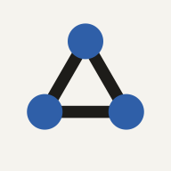

#  Agent Hub

A local-first operations layer for AI agents and their humans, shipped as one
lean binary or container on a homelab or NAS node. The node is the cloud.

Agent Hub gives a fleet of agents, spread across machines on a LAN or tailnet,
three things they otherwise lose and one calm place for the human to watch:

- **Session brains.** Every agent session keeps its working state on the node,
  not in the client's context window, so it survives compaction and a resume of
  the same named session.
- **A project feed.** "What happened in project X" is a first-class, time
  ordered, addressable query that agents read on startup and humans read as a
  feed.
- **A place for you.** A global inbox for finished work and approval requests,
  artifact hosting with browser-side encryption and password sharing, search,
  and a wiki over each project's durable knowledge, all reachable from an
  installable app.

Agents reach the hub over the Model Context Protocol (MCP). Humans reach it
over the PWA. There is no vendor cloud and no brain off the node.

> **How this was built.** This is a personal experiment, and most of the
> building was done by agents. I wrote the specification, the decisions, the
> operating model, the interface and experience design, and the review
> standards; agents wrote the implementation, the tests, the documentation and
> most of the refactoring from them, with me reading and correcting as they
> went. I would rather say that plainly than let a finished-looking repository
> imply a method I did not use.

## Screenshots

Captured from a seeded hub at desktop and phone widths. Each image follows your
colour scheme; the full tour is in
[the wiki](https://abn.github.io/agent-hub/screens.html).

<picture>
  <source media="(prefers-color-scheme: dark)" srcset="docs/assets/screens/home-desktop-dark.png">
  
</picture>

| Inbox | Project feed |
|---|---|
| <picture><source media="(prefers-color-scheme: dark)" srcset="docs/assets/screens/inbox-desktop-dark.png"></picture> | <picture><source media="(prefers-color-scheme: dark)" srcset="docs/assets/screens/feed-desktop-dark.png"></picture> |

| Artifacts | Search |
|---|---|
| <picture><source media="(prefers-color-scheme: dark)" srcset="docs/assets/screens/artifacts-desktop-dark.png"></picture> | <picture><source media="(prefers-color-scheme: dark)" srcset="docs/assets/screens/search-desktop-dark.png"></picture> |

## Install

The quickest way to see it, on the machine you are sitting at:

```sh
podman run --detach --name agent-hub \
  --publish 8080:8080 \
  --env HUB_ADMIN_TOKEN=change-me \
  --volume agent-hub-data:/data \
  ghcr.io/abn/agent-hub:1.0.0
```

`docker run` takes the same arguments. Open `http://127.0.0.1:8080/` and paste
the admin token. The image is distroless, runs as a non-root user, and keeps its
data in the named volume.

For a durable setup, a release binary, or a build from source, follow
[Get started](docs/start/index.md): it picks a lane for your hardware and walks
you through install, first login, and the first agent. Every setting is in
[Configuration](docs/reference/configuration.md), and running it as a service is
in [Deploy as a service](docs/operate/deploy-as-a-service.md).

> The hub must be reachable from every machine an agent runs on. A LAN or public
> bind carries plain HTTP, so terminate TLS in front or reach it over a tailnet;
> [Network and access](docs/operate/network-and-access.md) covers both.

## Connect an agent

Every hub serves its own bootstrap guide at `/bootstrap/SKILL.md`. Give an agent
that URL and it has what it needs: the hub's address, how to request a token,
and the MCP endpoint. An agent with no token asks to be let in, and you approve
it in your inbox.

```sh
curl -sS http://127.0.0.1:8080/bootstrap/SKILL.md
```

The same guide is the installable `agent-hub` skill, served over MCP at
`skill://agent-hub/SKILL.md` and installable with `npx skills add abn/agent-hub`.
The step-by-step for the operator is
[Connect your first agent](docs/start/connect-first-agent.md); the agent's own
working loop is [Using the hub as a brain](docs/guides/agents/operating.md).

## Documentation

The wiki lives in [`docs/`](docs/index.md) and is published to
[GitHub Pages](https://abn.github.io/agent-hub/). It is an OKF v0.2 bundle with
two front doors:

- **Running it:** [Get started](docs/start/index.md), [Guides](docs/guides/index.md),
  [Operate](docs/operate/index.md), [Reference](docs/reference/index.md).
- **Building it:** [Architecture](docs/architecture/index.md),
  [Design](docs/design/index.md), [Contributing](docs/contribute/index.md),
  [Decisions](docs/adr/index.md).

What shipped in each version is in [CHANGELOG.md](CHANGELOG.md), and
[RELEASING.md](RELEASING.md) is the runbook for cutting one.

## Development

```sh
make setup
make check
```

`make setup` installs the git hooks, creates the scratch area, and writes the
local assistant shims. It is idempotent and safe to re-run. `make check` is the
quality gate that hooks and CI both reuse. The
[contributor guide](docs/contribute/guide.md) has the full workflow.

`AGENTS.md` is the operational contract for humans and agents alike, and
[CONTRIBUTING.md](CONTRIBUTING.md) is the short version.

## Licence

MIT. See [LICENSE](LICENSE).
