# Human interface

The human surface is a calm mailroom for the operator's agents: quiet by
default, one step louder when something waits, never alarming. This page
records the design system behind it: the tokens, the type and glyphs, the shell
and its screens, the interaction rules, accessibility, and the copy rules.
`DESIGN.md` at the repository root is the design contract; it states the rules
the build is held to and records where the build deviates from the designer's
handoff and why. This page records the system and the shipped behaviour.

> [!NOTE]
> The installable PWA shell, its screens, and the rules below ship. Three
> gestures are intended design rather than shipped behaviour: the edge swipe
> back, the tab swipe, and swipes on feed rows. Offline reading for the
> knowledge base is also to be evaluated: what is cached today is the app shell
> and its assets, not page content.

## Tokens

`web/tokens.css` is the design's token file, and `web/app.css` holds every
class a screen draws. A `style` attribute carries only a value the script works
out at runtime: a width or flex share computed from data, a frame's reported
height, a custom property set from data or layout, a menu's position, a
gesture's transform, and a `display` toggle driven by state. Every other
declaration is a class, where the token, type and control-size gates read it. A
value the token file does not carry is a design question, not a local decision.

- **Themes.** Warm paper in light, warm charcoal in dark, switched by a
  `data-theme` attribute on the root element and following the operating system
  by default. A system that changes while the app is open changes the app with
  it, status bar included; a theme the reader chose follows nothing. Nothing is
  fetched from a CDN and no webfont is shipped, so the fonts are system stacks.
- **Surfaces.** A canvas, a row and card surface, and an inset surface, with
  two line weights for dividers and control borders.
- **Ink.** A primary, a secondary at 6.3 to 1, and a meta tone at 5 to 1 on the
  surface.
- **Accents.** An accent for unread, links, focus and selection; an action tone
  for waiting items and approvals; an ok tone for resolved and active; and a
  danger tone reserved for deletion.
- **Event kinds.** Each of the six families has a colour and a background
  partner, used only inside the glyph badge or as a two pixel accent, never as
  body text. An answer borrows the question tone: it is the reply on that
  thread, not a family of its own. A seventh pair, an olive, is the knowledge
  tone, drawn only by the Storage breakdown's knowledge segment and legend, so
  a byte count never borrows the question tone, which means "an agent is asking
  you".
- **Foundations.** A focus ring, two shadows, three radii, a four step spacing
  scale, and a type scale from 12 to 28.
- **Density.** Compact switches row padding only, from 12px to 8px, never type
  size.

Two values depart from the handoff, and the design contract records both. The
action tone is one step darker than the foundation draws it, because the
foundation's value falls below the AA threshold on the inset surface and on its
own background; `--k-approval` is that same value, so the button that asks for
a decision and the badge that marks one are a single colour. The field border
is also darkened by one step, because an empty field's border has to meet the
3:1 non-text minimum against the field's own surface, since an empty field has
nothing else inside it that says a control is there. No colour is written
twice: the manifest, the shell, the icon and the artifact frame all use values
the token file declares.

Radius, spacing and type are tokens. Radius is `--r-1`, `--r-2` or `--r-pill`,
spacing uses the `--s-*` steps from 4 to 32, and type uses the `--t-*` sizes.
`make web/styles` counts the declarations that still carry a length the token
file does not declare, pins the count and only lets it fall, and names on its
allow-list what is structural rather than a step: a band's own height, a
control's own box, a row's own rhythm, a hairline, a glyph column and an offset
that pulls an object back under its own edge.

## Type and glyphs

The scale runs 28 for a page title, 22 for a section, 17 for an item title, 15
for a row title and for body, 13 for meta, and 12 for an uppercase section
label and for mono data. Titles hold a line height of at least 1.3 and body
sits at 1.45 to 1.6. There is no 14: a size between meta and body was two sizes
in practice, and every use has moved to 13 or 15. A floor of 12px applies to
any interface text; where the handoff specifies 11px, 12px wins, and 9px
becomes 12. This is a build gate, not a preference.

There is one section-label style: 12/600 uppercase sans with 0.06em tracking in
the meta tone. A label that carries literal data, a count or a path, keeps it
in a span of its own rather than setting the whole label in mono, because a row
of labels drawn two ways reads as two different things.

Twelve line glyphs are inline SVG, a 24 viewBox, `currentColor`, stroke 1.7 to
2.4 with round caps and joins, and are never loaded as an image. The set is
anchor-pin, chevron-back, chevron-down, chevron-right, comments, copy, copy-raw,
lock, overflow, resolve, close, and send; the design's `key` and `link` are
drawn by no screen. The knowledge base tree draws three more inline glyphs of
its own, file, folder and clock, outside this set. One motif per glyph: `copy`
draws a sheet with its duplicate and means the clipboard, `copy-raw` draws
brackets and means source,
and the two never sit side by side without their labels; `overflow` is the only
filled glyph; a count is text, not a motif. A glyph that is a control's only
label carries an `aria-label` naming the object it acts on, for example "Copy
path brain/kv/working-on", and a glyph beside a visible word is `aria-hidden`.
A check holds that no two names draw the same path and that no drawn glyph is
unused.

Every event kind draws its own mark inside the badge: a dot for a signal, a
check for finished work, a question mark, an exclamation mark for an approval,
a document for an artifact, a half disc for a session, and a reply arrow for an
answer. The badge itself is hidden from assistive technology, and the row
carries a visually hidden word for the kind instead, once, so the kind survives
both a reader who cannot separate the tints and a reader who hears the page.

## Layout: the shell

One shell serves the feed, artifacts, sessions and the inbox. Four zones, in
order:

| Zone | Width | Present when |
|---|---|---|
| Rail | 200, fixed | always |
| Index | 300 default, 260 to 480, draggable | always, feed and inbox included |
| Stage | `1fr`, never under 560 | always |
| Aside | 320 default, 288 to 440, draggable | only where something is read against the stage |

The rail is navigation, not a pane. It is one 52px identity block, then rows,
then a footer, and it owes no control row. The project's section switcher is a
segmented control inside the index header, not a tab strip above the panes: it
selects what the index lists and never changes the shell. The inbox is the same
shell with one index and no switcher.

An index exists only where items are opened one at a time, so Settings is the
one screen with no index: a short form is not a list. An aside exists only
where something is read against the stage, which is anchored comments on an
artifact and a brain `kv` key. Correspondence, a feed or inbox thread, is the
stage, not a panel, and the aside toggle is absent, not disabled, on feed,
inbox and settings.

**The frame does not move, on a desktop.** Every pane reserves a 52px header
and a 40px control row, in that order, whether or not it has anything to put in
them, so content starts at the same y in every pane of every section. An empty
control row is correct; a missing one is a bug. No control is taller than the
band that holds it: a header or control-row control is drawn at 32px on a fine
pointer. Two desktop screens depart and the design contract records both:
Search draws a 48px header and no control row, and More, the phone's tab root,
reaches a desktop only by its address and has no control row.

One gutter belongs to each pane, and every heading, label and row a screen
writes starts on it; a pane hands the gutter to its rows rather than each
declaring a padding of its own. Prose is left-aligned in the stage and capped
at 640, so panes may change width but the reader's place in the prose may not.
A list's glyph column is a fixed box, 20px in the index and 28px on the mobile
feed, so every title starts at the same x with or without a glyph.

A summary is a **subject** when it is one line of at most 100 characters, and a
**message** when it is longer or holds a newline. A subject is the item title
and nothing else; a message titles the item with its leading sentence and reads
the rest as body prose beneath, at 15px and normal weight. The split loses no
characters: the two together hold the whole summary. A heading never carries a
whole message.

<picture>
  <source media="(prefers-color-scheme: dark)" srcset="../assets/screens/feed-desktop-dark.png">
  
</picture>

<picture>
  <source media="(prefers-color-scheme: dark)" srcset="../assets/screens/feed-phone-dark.png">
  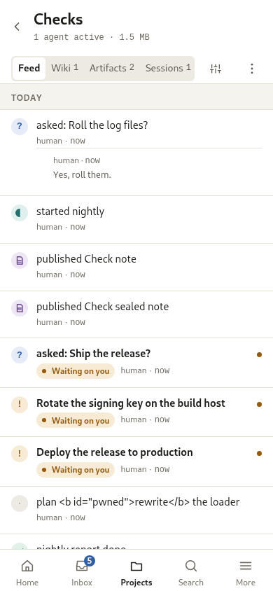
</picture>

Index and aside are resizable by a 5px splitter, the pane divider itself, with
`cursor: col-resize` and a 1px hairline. Dragging uses pointer events and never
mouse events; double-click resets to the default; the width persists per pane,
per device, in `localStorage`. The stage clamp wins: a drag or a key that would
take the stage under 560 stops. The splitter is `role="separator"`,
`aria-orientation="vertical"`, focusable, with `aria-label`, `aria-valuemin`,
`aria-valuemax` and a live `aria-valuenow`; Left and Right move it 16px, Shift
48px, Home or Enter resets. Focus is visible: the hairline becomes the accent
and takes a 1px accent ring.

Mobile is 390 primary. The desktop shell takes over at 900px for the artifact
table to row-list switch, and the app rail is permanent on the desktop. Prose
keeps its 640 cap at every width; wide screens give the extra room to structure,
not to line length.

### The phone

On a phone the frame is one header and one tools row. The header is 76px at
rest (title 22/600, its meta under it) and 52px once the list is scrolled past
20px (title 15/600, meta hidden), over 120ms and instant under reduced motion,
with hysteresis at 20 and 8; under it sits one sticky 44px tools row holding
that screen's tools, and nothing when the screen has none. Content starts at y
120 at rest and y 96 scrolled. The 48px leading slot and the title's left edge
hold on every screen in both header states, and because a phone reader's place
is their scroll position, the phone reserves no band. Home is the one exception
at rest: it has no bar and its greeting is content at x 16, with the bar fading
in at x 48 once the greeting leaves.

The tab bar is five labelled tabs: Home, Inbox, Projects, Search, More. More is
a tab root, not an overlay or a bare hamburger, and it holds Storage, Agents
and tokens, Settings and the sync line. Pushed screens from More retain More as
the current tab and offer a back chevron in the 48px leading slot. Lists are
flat rows, edge to edge under a hairline, with the inbox row as the model; a
card means "this is a summary", and only Home's storage summary is one.
Settings is rows with quiet group labels, no panels and no tools row, and it
shows the data path once, last two segments, with a copy glyph. Single-key
shortcuts are absent under a coarse pointer, and no screen prints the hub's
admin token, masked or not.

### Forms

A form is a 640 column at every width, whatever the pane it sits in; where the
pane is narrower than 640 the column is the pane, so a phone form is the stage
and a desktop one is not. A settings row is 48 whatever its control: the
control is drawn at `--ctl`, so 32 inside the row's 16px of padding is exactly
48, and the separating hairline is one of the 48. A row whose label carries a
second line of copy grows to hold that line, and never because of its control.
Under a coarse pointer a row is 56, because a `--tap` control inside 12px of
padding is 56 and 48 cannot hold the target. A button is as wide as its label;
a control that is itself a row, a menu item, or a tab of a strip is as wide as
the box that holds it, and a control that draws only a glyph is held to `--tap`
rather than to a label. Under a coarse pointer a dialog's or a form's action
row takes the sheet's width between its actions, so no verb is left at its
label's width beside an empty sheet; the primary keeps its emphasis by its fill
rather than by its width.

## Screens

Eight screens share the shell: Home, Inbox, Project (feed, artifacts, sessions
and the knowledge base under one shell), the artifact viewer, session detail,
Search, Storage and prune, and Settings, with Agents and access on its own
screen reached from Settings and Connect as the token gate. Each screen's
design is below; the routes and the fields they carry are in
[REST API](/reference/rest-api.md).

### Home

Home is welcoming at rest: a status strip, a title that is the reader's own day
and part of day over a summary line, the waiting card, the newest across
projects, and storage. Below the width the top bar shows at, the node line of
the design's status strip is drawn in mono. The waiting card holds the queue's
count, the first three items that wait, each opening its own item, and a link to
the rest in the Inbox. Home's lists are flat rows and the storage summary is
the only card, because a card means "this is a summary". When nothing waits,
nothing is unread and nothing sits above a cursor, the two cards give way to
the quiet empty state.

<picture>
  <source media="(prefers-color-scheme: dark)" srcset="../assets/screens/home-desktop-dark.png">
  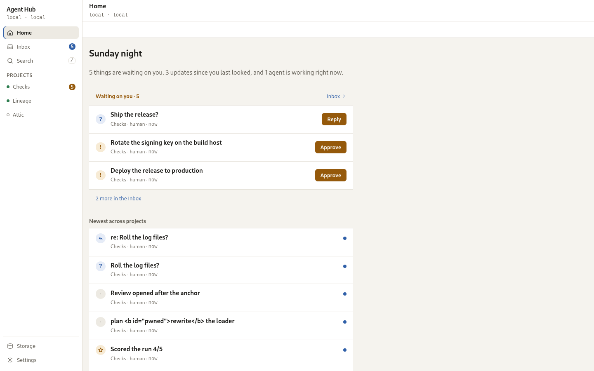
</picture>

<picture>
  <source media="(prefers-color-scheme: dark)" srcset="../assets/screens/home-phone-dark.png">
  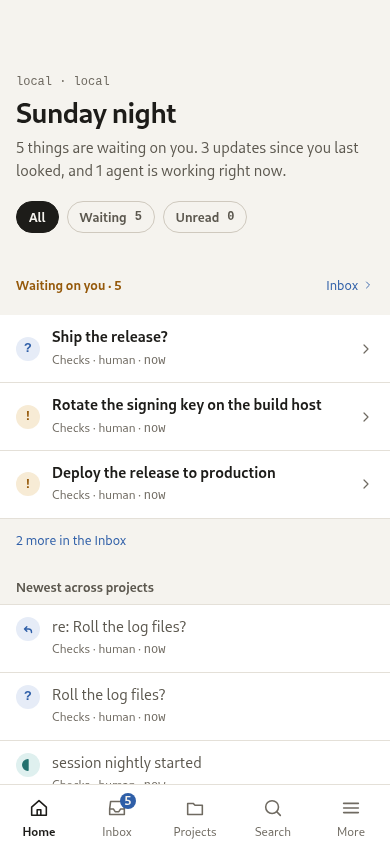
</picture>

### Inbox

The global queue in groups: WAITING ON YOU with its count, its open items
grouped by actor; SNOOZED when items are deferred; UNREAD with its count; and
EARLIER, read and resolved items. A waiting row carries the action dot at the
row's end and a 600 title, and no pill, because the group names the state; a
snoozed waiting row carries the pill on its meta line. Waiting outranks unread:
a waiting row ends in the action dot and not the unread dot. The stage is the
whole item: pill, title, body, its buttons, its thread, and a card naming what
it points at. A question's quick answers sit above its composer when it
suggests any, and a row's Reply opens the same composer. An item the asking
agent gave a deadline says what the deadline will do on its row and on its
card, in words with the time left, as one 12px line in the meta tone, never a
ticking countdown; an item the hub resolved at its deadline reads as expired,
apart from a human decision, so a reader never takes the hub's call for their
own.

<picture>
  <source media="(prefers-color-scheme: dark)" srcset="../assets/screens/inbox-desktop-dark.png">
  
</picture>

<picture>
  <source media="(prefers-color-scheme: dark)" srcset="../assets/screens/inbox-item-phone-dark.png">
  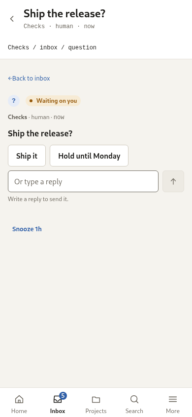
</picture>

### Project

The Projects register lists every project with its live counts, and each row
leads to the project's feed. A project is its own address: the feed, the
artifact gallery, the sessions list and the knowledge base are the four
segments of one shell, each with its own route. The index header carries the
segmented switcher and the filter field under it; the switcher states that it
drops its counts when the pane is narrow, and a project's four tabs read in
full at the default width. An event opens in the stage with a "Points at" card
carrying the reader to the artifact or session it is about. A project with
items waiting draws an amber badge and one with unread items an accent badge,
with amber taking priority when both exist.

<picture>
  <source media="(prefers-color-scheme: dark)" srcset="../assets/screens/projects-desktop-dark.png">
  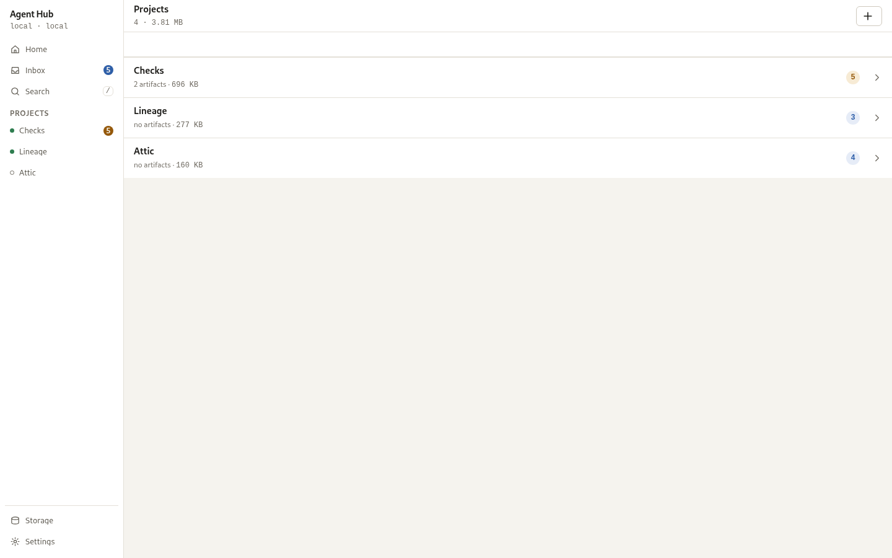
</picture>

### Sessions and session detail

The sessions index groups sessions into active and ended, each row carrying the
middle-truncated session id and its working name on the title line, a state dot
and its status, the owner, the time and a right-column mono size. The session
detail draws the brain tree in the stage: a `kv` key is read in the aside, named
in mono with the copy glyph, and on a coarse pointer the same value opens as one
bottom sheet opened by the tree leaf. An `fs` file opens in the stage rendered
by the same parser as an artifact, read-only, with a back control and a mono
provenance line. The header side carries the owner, the handoff note and the
lineage, with a Reassign control beside the copy-id glyph; Reassign never takes
the Prune or End slot, which belongs to the session's own life. The session id
appears once, in the stage header's meta line, with the copy glyph on the row
that owns it.

<picture>
  <source media="(prefers-color-scheme: dark)" srcset="../assets/screens/session-detail-desktop-dark.png">
  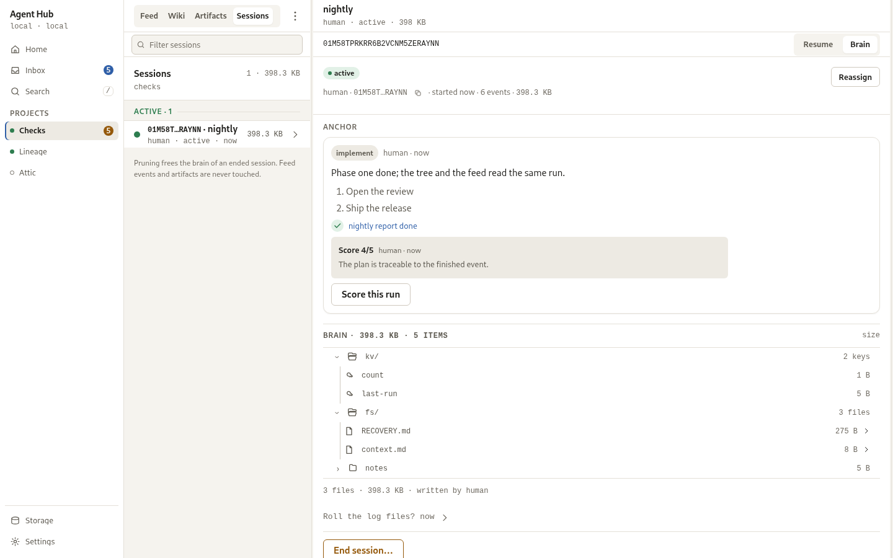
</picture>

<picture>
  <source media="(prefers-color-scheme: dark)" srcset="../assets/screens/session-detail-phone-dark.png">
  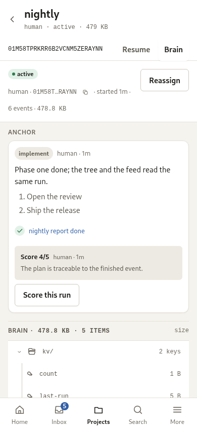
</picture>

### Artifacts

An artifact has one surface. It is read in its project's Artifacts shell with
it selected in the stage, beside the index with its row marked, and on a fine
pointer at desktop widths the comments aside. Below that, or under a coarse
pointer, the same threads open in one sheet, and never both. The address a link
carries is replaced by the shell's own, so there is no second chrome for the
same document and Back leaves the artifact rather than landing on a hop that
forwards again. The stage's control row carries the path, Copy path, the
version control and Copy raw, each a 32px band control on a fine pointer and
answering to a 44 by 44 target under a coarse one. The version control opens
the version sheet with whole-save history, and a version an agent is holding
live is listed there, labelled as being written, while the stage carries a 34px
live band above the document naming that agent, with follow or pause and the
state word; a sealed artifact shows nothing. Comment authors are distinguished
visually, and resolved threads carry a check glyph and the word Resolved rather
than dimming alone.

<picture>
  <source media="(prefers-color-scheme: dark)" srcset="../assets/screens/artifacts-desktop-dark.png">
  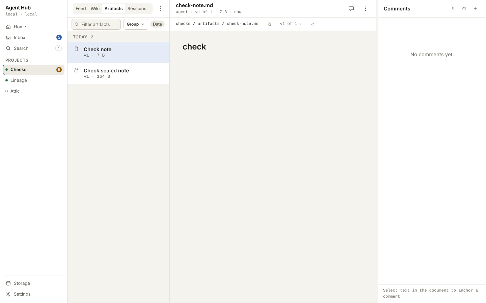
</picture>

<picture>
  <source media="(prefers-color-scheme: dark)" srcset="../assets/screens/artifact-viewer-phone-dark.png">
  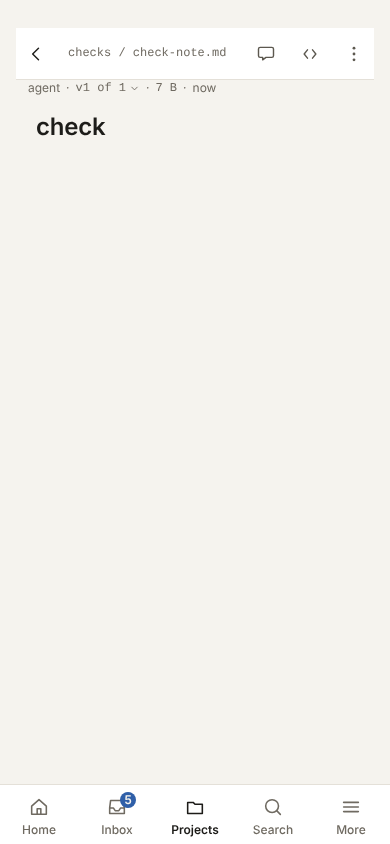
</picture>

### Search

One field over the feed, artifacts, session brains and knowledge base pages,
answering as it is typed. The query and the scope live in the route, so a
reload or Back lands on the same results, and an answer that arrives after a
newer query is dropped. Scope chips are filters and show no count where none is
known before a query runs. Results are flat rows grouped by family in one list
rather than tabs, each carrying its title, the snippet with matched words
marked, the project by its display name and when it changed. Matched words are
marked directly in the title with an action-tinted `<mark>`, without a repeated
snippet line beneath it. From the desktop shell, Search is a two-pane layout
with a results index and a preview stage, where selecting a result previews it
without navigating away; the preview header carries the match position beside
previous and next step buttons and an Open link.

<picture>
  <source media="(prefers-color-scheme: dark)" srcset="../assets/screens/search-desktop-dark.png">
  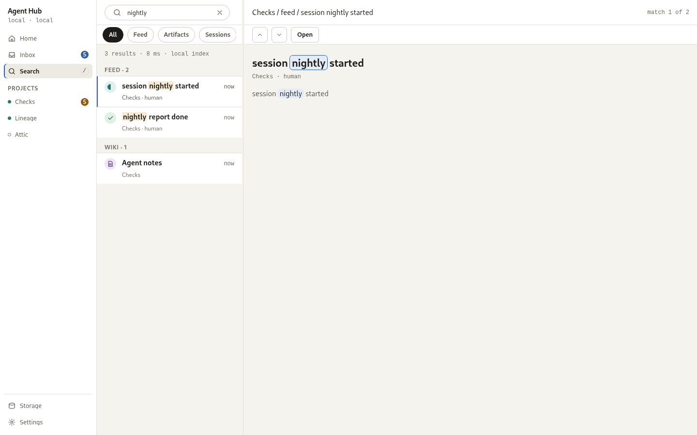
</picture>

### Storage and prune

Storage shows the data path and node, what is used against the volume's own
capacity, and a stacked bar by kind whose legend carries each kind's byte figure
in words, so the bar is never the only place a number lives. No segment is ever
widened, and a zero cell reads a dash. A row per project shows its total, its
own 4px bar split four ways to scale, and the same split in words, with a Prune
button carrying the bytes its ended sessions would free. Prune is confirmed in a
dialog that opens with the safe action focused, then reversible for 30s in a
toast, then committed. Storage never touches feed events or artifacts, and a
project a prune has just emptied keeps its row.

<picture>
  <source media="(prefers-color-scheme: dark)" srcset="../assets/screens/storage-desktop-dark.png">
  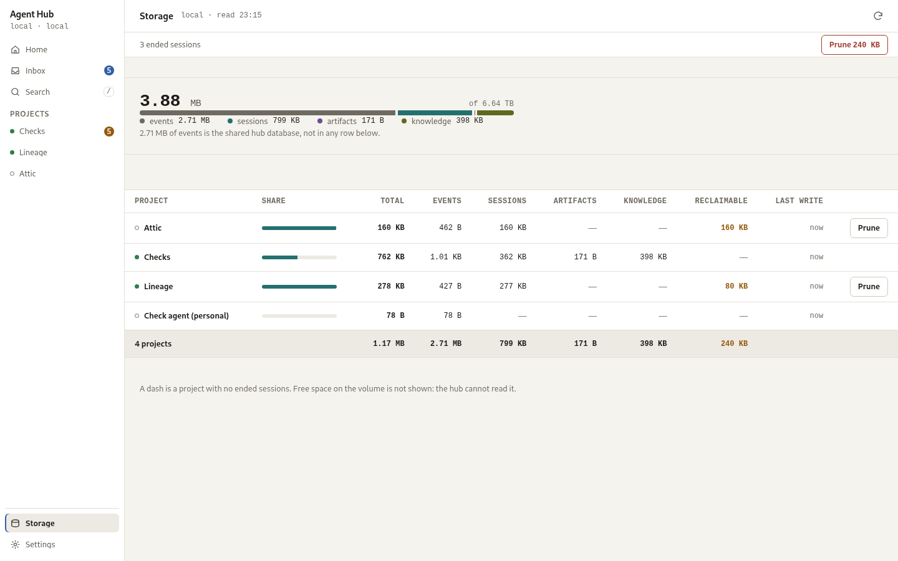
</picture>

<picture>
  <source media="(prefers-color-scheme: dark)" srcset="../assets/screens/prune-desktop-dark.png">
  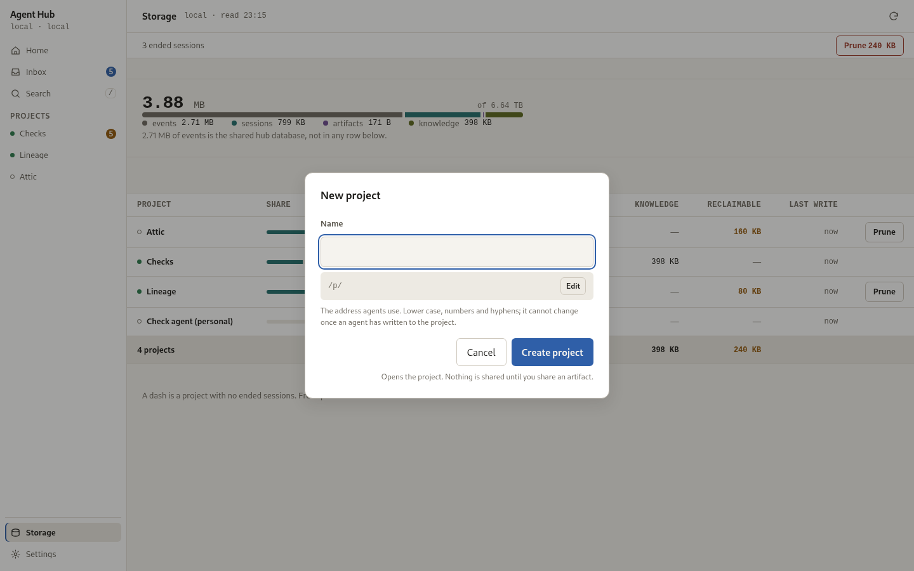
</picture>

### Settings

Settings is a 640px column of 48px rows under three quiet group labels: THIS
DEVICE (theme as a three-way segmented group, compact rows, waiting on you),
KEYBOARD (single-key shortcuts, the group absent under a coarse pointer), and
THIS HUB (storage, agents and tokens, Connect, and Version). Version is a value
row reading the version and short commit the binary was built from, with no
destination, no chevron and no tab stop. One helper line in the whole screen,
and no paragraph explains a toggle. Theme shows a three-way group (System,
Light, Dark) and density a pointer-derived group; the phone's other
destinations live under the More tab root.

<picture>
  <source media="(prefers-color-scheme: dark)" srcset="../assets/screens/settings-desktop-dark.png">
  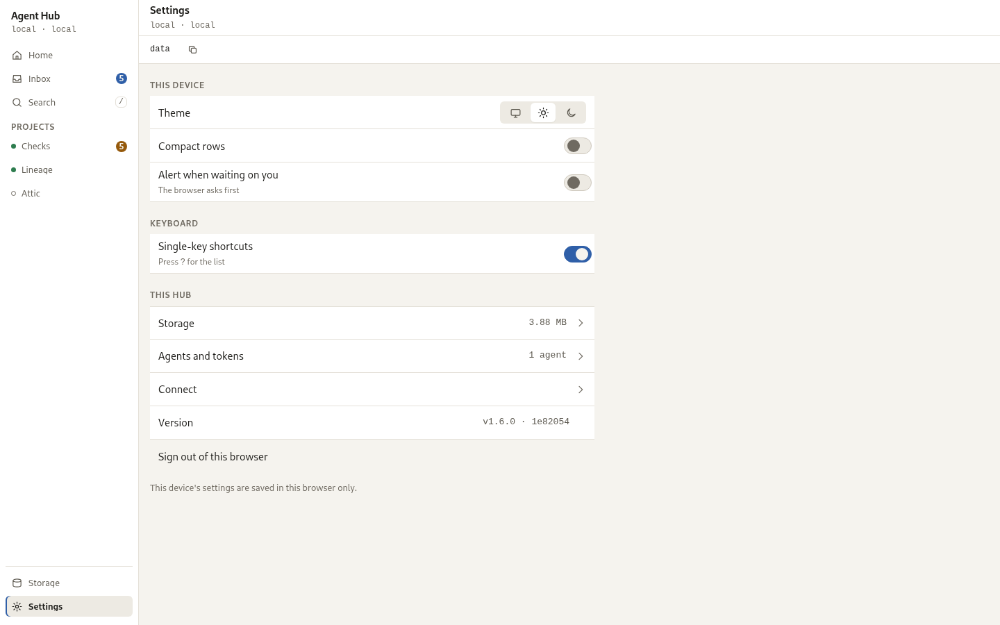
</picture>

<picture>
  <source media="(prefers-color-scheme: dark)" srcset="../assets/screens/more-phone-dark.png">
  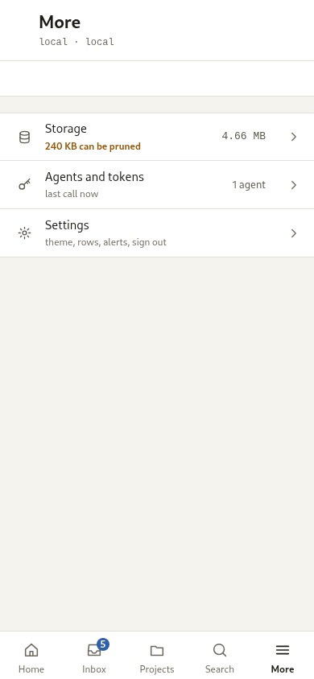
</picture>

### Agents and access

Access management lives on its own screen reached from Settings, linked from an
Access row. It displays the admin token with a copy control and a note that it
comes from startup configuration and changes on restart with a different
`HUB_ADMIN_TOKEN`. Agents are records with their personal space path, beside
controls to reissue or revoke a token and to remove project grants under a
confirmation dialog. A grant is access or no access, with no read or write
level, so no screen renders read or write as an access value. The lock glyph
and the word "confidential" appear only on a confidential project, and the
project's own screen carries the two directions, Make confidential and Make
public, in its overflow. Revoking a token stops the token and nothing else, so
the screen keeps revoke and grant removal as separate controls.

<picture>
  <source media="(prefers-color-scheme: dark)" srcset="../assets/screens/access-desktop-dark.png">
  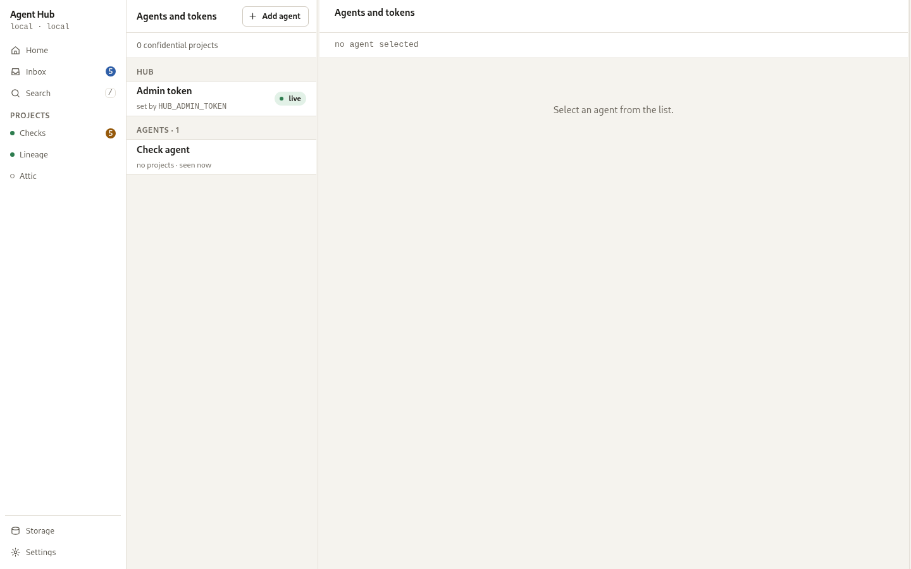
</picture>

### Connect

A screen the hub refuses to paint sends the reader to Connect, carrying the
route it interrupted, so a token entered is followed by the screen they were
going to rather than the start. One password field with a Show token control, a
hidden username field so a password manager stores the pair, and copy naming
where the token comes from. The token is checked against the hub before it is
kept, so a token the hub refuses never becomes the one every later screen
sends. A refusal shows the hub's own words in a live region beside the field,
keeps what was typed and returns focus to it, and stores nothing. Settings has
no field of its own; it links here to change a token. A hub with no admin token
configured says so and points at the startup fix rather than repeating the
refusal.

<picture>
  <source media="(prefers-color-scheme: dark)" srcset="../assets/screens/connect-desktop-dark.png">
  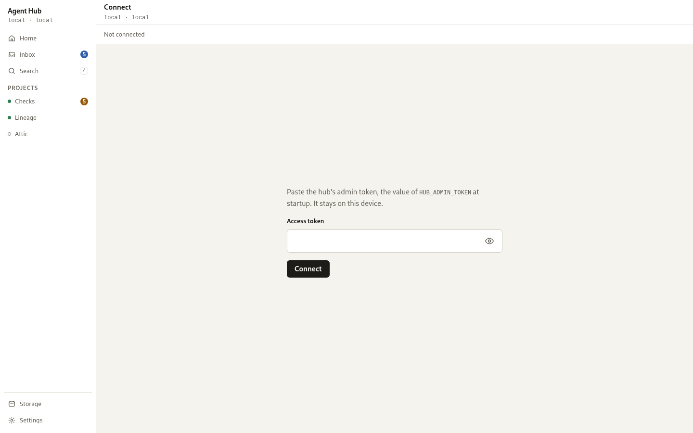
</picture>

### Dialogs

The dialogs are where a decision is taken. Each traps focus, opens with the
safe action focused, treats Esc as keeping, and hands focus back to the control
that opened it. End session is not prune: ending stops something live and
cannot be undone, so it is an outline in the action tone with a confirmation,
while prune deletes bytes and takes the danger tone. Danger is reserved for
deletion, and it fills only inside the dialog that confirms it.

<picture>
  <source media="(prefers-color-scheme: dark)" srcset="../assets/screens/new-project-desktop-dark.png">
  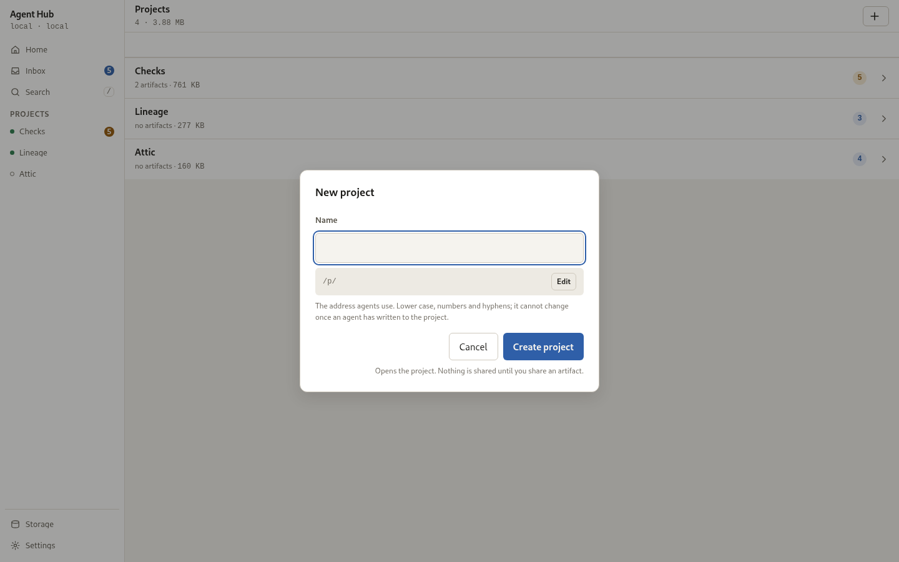
</picture>

<picture>
  <source media="(prefers-color-scheme: dark)" srcset="../assets/screens/delete-project-desktop-dark.png">
  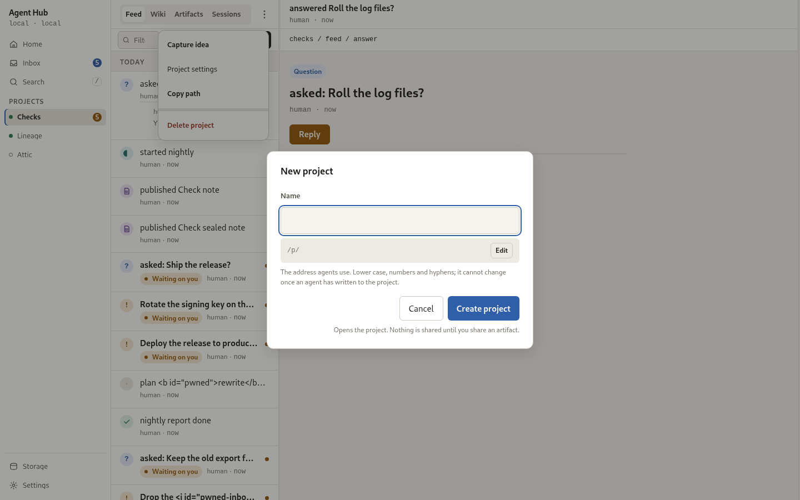
</picture>

<picture>
  <source media="(prefers-color-scheme: dark)" srcset="../assets/screens/end-session-desktop-dark.png">
  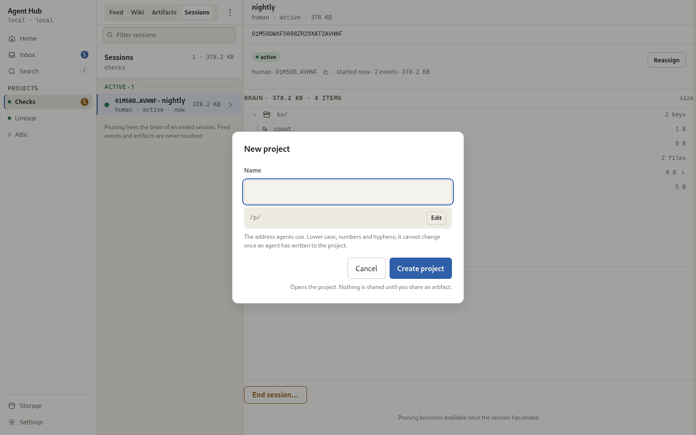
</picture>

<picture>
  <source media="(prefers-color-scheme: dark)" srcset="../assets/screens/issue-token-desktop-dark.png">
  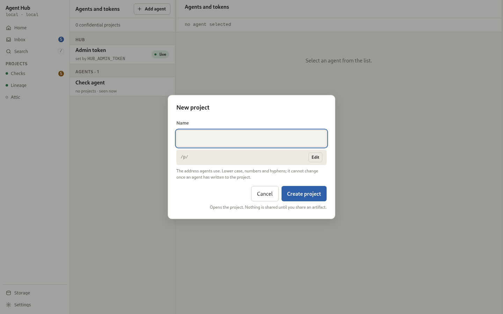
</picture>

<picture>
  <source media="(prefers-color-scheme: dark)" srcset="../assets/screens/revert-desktop-dark.png">
  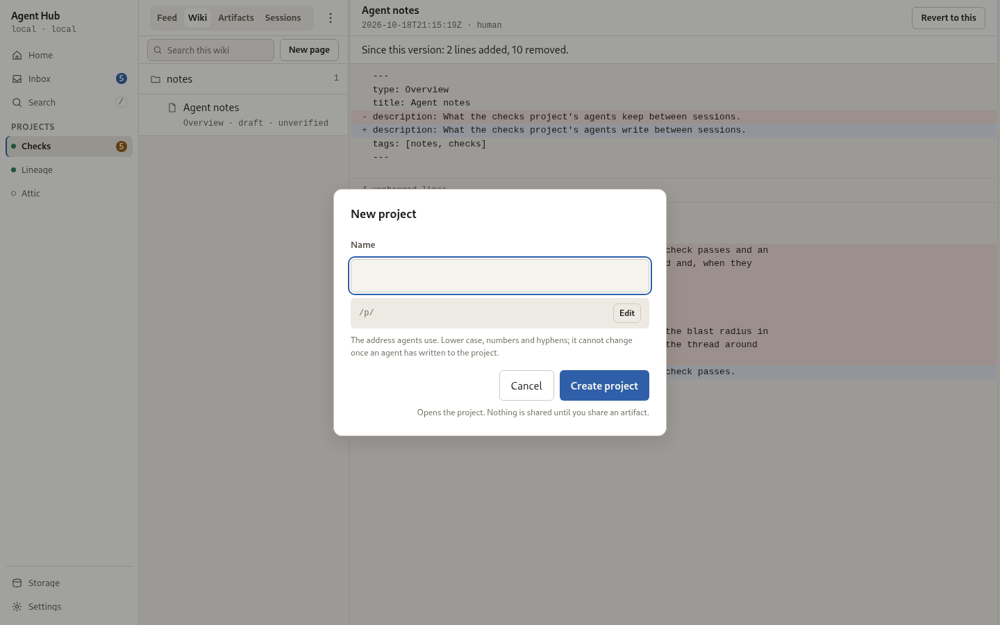
</picture>

## The project knowledge base

### The tree

A project carries a fourth section, Wiki, beside Feed, Artifacts and Sessions,
and its tab names the page count. The tree is one listing of the whole
knowledge base, drawn as a full tree from 768px up and one drill-in level below
that; inside a directory the drill-in level carries a breadcrumb, and at the
root it carries none because the tools row above already names the section. A
page row carries its title and a mono line of its type, status and derived
trust, and a stale page adds the 12px clock glyph and the word "stale".
Selecting a page opens the reader in the stage: the frontmatter block is
metadata, drawn as the page's type, status and tags rather than as body text,
and the page's backlinks and comment threads are listed under it.

### Reading and editing

The reader offers Review, which stamps the bytes the human read and carries the
version they read, and Edit, whose Save carries the version token the read
carried; a page that changed under the editor is refused rather than
overwritten, and the refusal is said in place with Reload theirs and Keep mine.
New page and Save to wiki are one sheet: a Location, a Title and a Description,
the file name computed from the title, and a note naming the type, status and
source. New page writes a page that is not there yet; Save to wiki copies a
session brain entry in and leaves the source where it was.

### Page history and diffs

A page's History is a stage of its own, reached from a History link in the
reader's control row and from every Recent changes row. One row per version,
newest first, carries the short time in mono with "current" or "not kept" as a
word, then the actor, what the write did and its size; the full stamp is on the
time element as its title and its accessible name. A version opens as a line
diff against the page as it is now, each changed line marked `+` or `-` in its
own column with a hidden word for a screen reader, the added line tinted with
the accent and the removed one with the danger tint, so the tint repeats what
the mark says and never carries it alone. Unchanged runs fold to one 12px count
line, three lines of context either side of a change, and long lines wrap so the
diff never scrolls the pane sideways. The header carries Revert to this, or
Restore this for a deleted page, a neutral outline at the band's `--ctl`
because a revert is a new write that deletes nothing; it asks in a dialog that
focuses Cancel first and names what stays in the history. A diff past its edit
budget is not drawn as counts it cannot stand behind: the controls row says
there are too many changes to show line by line, and the stage shows the
version itself. The history's header carries Forget history, a danger outline,
since it deletes the kept bytes for good; its dialog names the page, says the
rows stay and focuses Cancel.

### Housekeeping

The Wiki home carries the page, needs-review and stale counts and holds Recent
changes and Lint, each a housekeeping screen reached from a well-known path. The
routes and refusals are in
[knowledge base pages](/reference/knowledge-base-pages.md).

<picture>
  <source media="(prefers-color-scheme: dark)" srcset="../assets/screens/wiki-desktop-dark.png">
  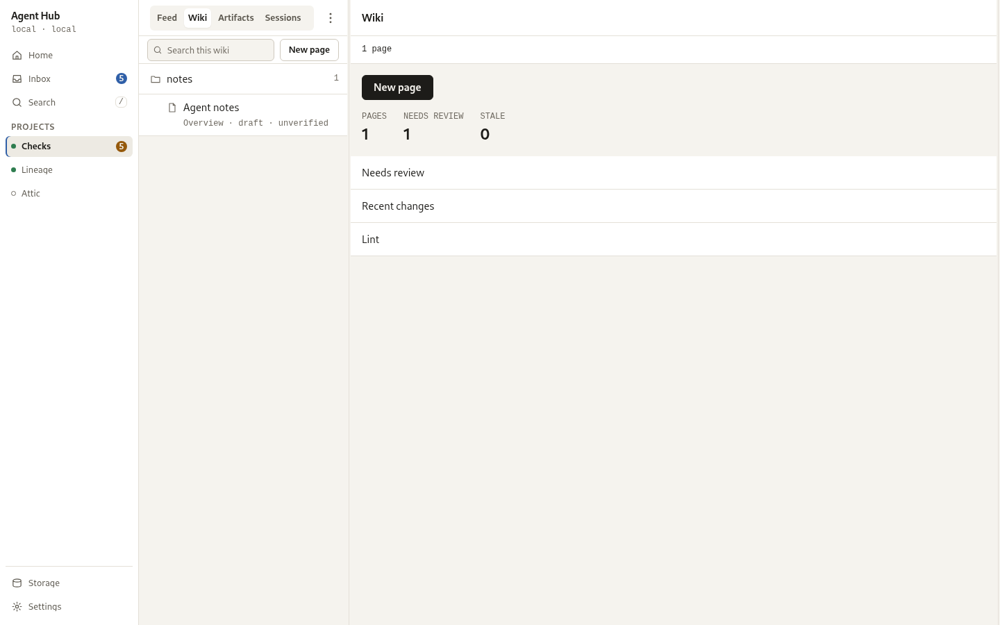
</picture>

<picture>
  <source media="(prefers-color-scheme: dark)" srcset="../assets/screens/wiki-reader-desktop-dark.png">
  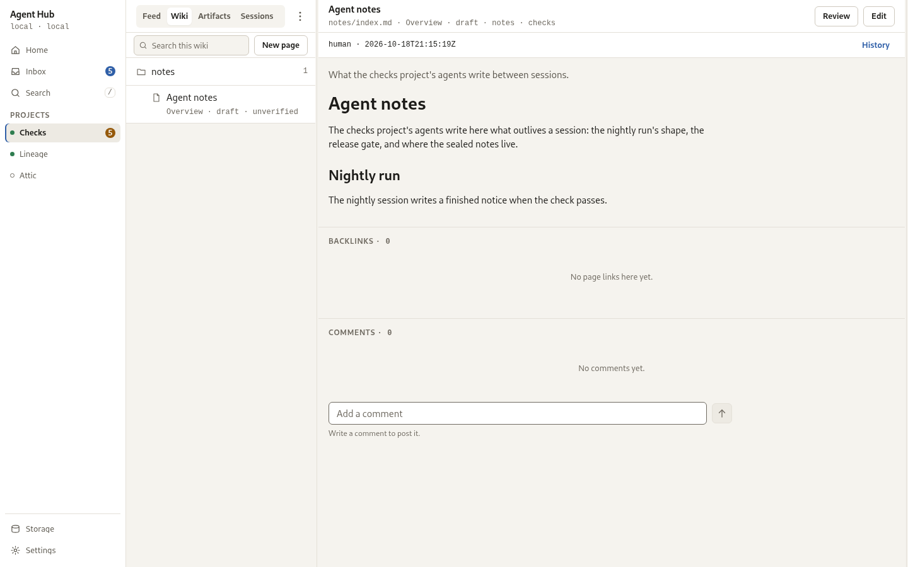
</picture>

<picture>
  <source media="(prefers-color-scheme: dark)" srcset="../assets/screens/wiki-editor-desktop-dark.png">
  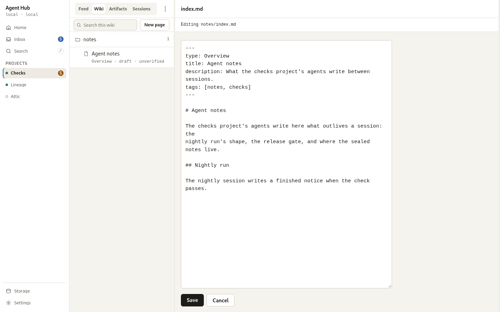
</picture>

<picture>
  <source media="(prefers-color-scheme: dark)" srcset="../assets/screens/wiki-history-phone-dark.png">
  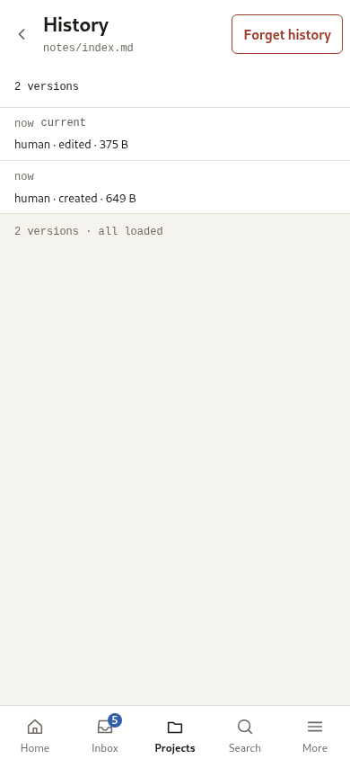
</picture>

<picture>
  <source media="(prefers-color-scheme: dark)" srcset="../assets/screens/wiki-diff-desktop-dark.png">
  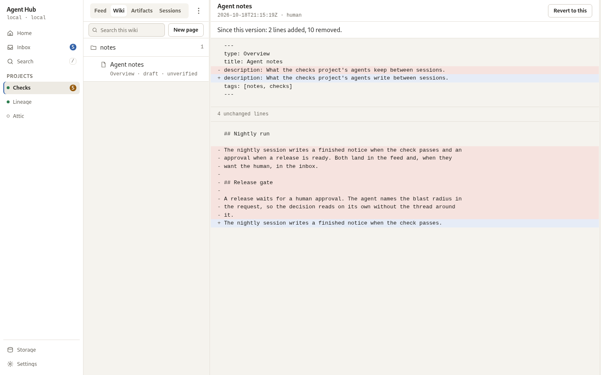
</picture>

## First run

A fresh hub opens on Connect, where the token is checked against the hub before
it is stored and the reader is returned to the route they were on. The Projects
register is reachable from the rail's PROJECTS header on the desktop and from
the tab bar on a phone, and a new hub's empty Home carries one call to action,
create a project. Creating an agent issues its token once and reveals it; on a
phone as well as a desktop the reveal offers the MCP setup for that agent with
the token embedded, so the two halves are not spliced by hand. A pending
enrolment reads in the inbox as "Pending enrolment" with the reason the agent
gave, and the Access list marks a pending agent and shows its reason. A hub
with no admin token configured says so on Connect and points at the startup
fix rather than repeating the refusal.

## Interaction rules

- Every verb is reachable in two taps from Home: read, answer, approve, prune.
- Read is explicit: opening an item, a swipe right, or the row's own control.
  Never scroll-past. The Inbox header carries Mark all read and an Unread only
  filter, and marking one item read or unread offers an undo.
- A swipe is first-class on mobile, never destructive, and always has a tap
  equivalent. The swipe-down toast dismiss ships, with a dismiss control and
  Esc beside it. An Inbox row's swipe right marks it read or unread and its
  swipe left uncovers the row's actions without deciding anything. The edge
  swipe back, the tab swipe and swipes on feed rows are intended design, not
  yet shipped.
- A waiting row keeps its title line for the subject in every index: it ends in
  the action dot, its title is drawn at 600, and the title takes the words
  "Waiting on you" as its accessible description, hidden from browse mode so a
  screen reader hears them once. Where a row is not under a WAITING ON YOU
  heading, in the feed and in the inbox's SNOOZED group, the status pill sits
  first on the meta line under the subject. On the meta line a long agent name
  is what gives way, never the time.
- Keyboard: `/` focuses the list's own filter field when the screen has one and
  otherwise search, `j` and `k` move a selection through the rows of the current
  screen, Enter opens the selected row, `a` approves, `r` replies,
  Ctrl+Enter (Cmd+Enter on an Apple device) sends from a composer, `c` toggles
  the aside, Esc closes what is on top, and the arrows move a focused splitter.
  The selection is a real focus move, so the ring shows it; painting a list
  never takes focus. Nothing fires while the reader is typing, while a modifier
  is held, or while a dialog holds the keyboard, and Settings carries a
  single-key shortcuts switch so a key that needs no modifier can be turned off.
- Time is short on a row and whole on request. A row carries a compact relative
  form in the reader's own locale, counting itself up while the app is open; the
  full local timestamp is the element's accessible name and its hover title, and
  a press swaps it in for a reader who cannot hover. No timestamp is a tab stop
  of its own: the row is the stop, and the full stamp is read with it.
- Search answers as you type, inside 50 ms of the last key, and keeps the query
  in the address so Back and reload return to it. The field never loses focus to
  its own results; the count is announced instead. The query is sent as typed,
  quotes and operators included, and the hub makes it safe for the index, so no
  query is refused.
- A question is answered in a composer under the item it belongs to, not in a
  browser prompt, and a refused send keeps what was typed and says why in place.
  One composer is every place the reader writes: a question's card and the row a
  Reply opens it under, an artifact's comments and replies, and a wiki page's
  comments. Its field grows a line at a time to eight lines and then scrolls,
  and its send control sits beside the field on the field's last line, as an
  icon with a name. While the field is empty the send control is dimmed and the
  line under the field says why. The composer is at most 640 wide.
- End session is not prune. Ending stops something live and cannot be undone,
  while prune deletes bytes. End session is an outline in the action tone with
  an ellipsis and a confirmation; Prune is the danger tone and appears as a fill
  only inside the dialog, and on a screen it stays disabled until the session
  has ended.
- What an action did is reported in a toast, which is a live region so it is
  announced. A toast that carries an undo takes focus, because the undo is the
  only way back; one toast is on screen at a time and a new one replaces it. It
  auto-dismisses at 30s when it carries an undo, 5s otherwise.
- Motion is never decorative. Reveals and underlines take at most 150ms,
  ease-out, and `prefers-reduced-motion` is honoured.

## Alert hierarchy

Three levels, and no more. Quiet for read, ended and signal items. Unread for a
dot, weight and a badge count. Waiting on you for the action dot, weight, an
action pill and a button, grouped at the top; on an index row the pill is on the
meta line, never the title line. Alerts are never red, never animated, and never
a modal.

## Accessibility

This is a build gate, not a guideline: WCAG AA in both themes, a 12px UI text
floor, a visible focus ring, a full keyboard path, and no meaning carried by
colour alone. Reduced motion is honoured.

Targets follow the pointer. Under a coarse pointer every control answers to at
least 44 by 44px, by its own box or by a hit area around it. Under a fine
pointer a control is drawn at the size its band gives it, and never under the
24px WCAG 2.5.8 minimum. Four tokens carry the sizes: `--ctl` 32px for a control
in a pane header, a control row or a row; `--ctl-sm` 28px for a glyph inside a
line of text; `--ctl-form` 36px for a field, a dialog action and any other
button; and `--tap` 44px for the target. No control is taller than the band that
holds it. Under a coarse pointer a button or a field is drawn at `--tap`, and a
smaller chrome control (a chip, a glyph, a segment, the filter field) keeps its
drawn size and answers to a `--tap` hit area around its centre, in both axes.
The hit area is there wherever a touch screen is, even one beside a mouse, and a
link drawn as a button is held to the same target. A link inside a sentence is
text, not a control.

The focus ring is the designed shadow over a transparent 2px outline, because a
browser in forced colours drops shadows and recolours outlines, and a ring that
is only a shadow is no ring at all there. A text field is drawn one step darker
than the design's hairline, since an empty field has nothing inside it that says
a control is there. An outline button keeps the hairline, because its own label
identifies it. A button's label is one style per control size: 15/600 where the
control is `--ctl-form` or `--tap`, and 13/600 where it is `--ctl` or
`--ctl-sm`.

The gate runs in layers. A hermetic contract check computes WCAG contrast for
every token pair on every surface it is painted on, enforces the 12px floor,
holds the two typographic badge marks to the text threshold rather than the
glyph one, and asserts the focus ring, the reduced-motion block, and the control
sizes for each pointer with the hit area that covers both axes, so it runs on
every machine. A browser pass then measures what the page actually resolved: no
text under 12px on any screen, no control in a header or control row taller than
32px or outside its band on a fine pointer, a 44 by 44 target for every button,
chip and field on a coarse pointer, a distinct mark per kind, and one kind word
per row. Both size checks walk every screen the router registers. A waiting row
in the feed and the inbox is held at both widths in both themes, set in a pinned
Cantarell so the numbers and pixels match on every host. A composer check opens
every composer at both pointers and holds its sizes, the send control's place on
the last line, the growth cap, the keyboard rule, the empty state and its
reason, and an optional axe pass renders the screens in both themes and reports
DOM, ARIA, label, heading, and computed-contrast problems. The last layers need
Playwright, a browser and an axe build, and skip cleanly when they are absent.

## Copy

Agent voice, past tense, no exclamation marks. Approvals name the action and
its blast radius. Toasts state what happened and the reversible path. Empty
states say what this is and what to do, in four parts: the screen's own name in
mono, a title, one line, and at most one way to act, with no illustration. The
one exception to "no Copy label" is that single way to act where the string it
copies is the whole point and there is no row to carry a glyph: the project
feed's empty state may read Copy MCP setup. There is no emoji anywhere; icons
are inline SVG line glyphs or typographic marks.

A grant is access or no access, so no screen renders read or write as an access
value. The revoke-token dialog says that the token stops working now, that
projects stay granted, and that a new token restores access. The stage's foot
reads Revoke token, and an agent with no live token reads "No live token" with
Issue token beside it.

## See also

- [Operating model](/architecture/operating-model.md) - the trust posture the
  screens render.
- [REST API](/reference/rest-api.md) - the routes and fields every screen reads.
- [Product tour](/screens.md) - every screen at both widths in both themes.
- [Decision 0015](/adr/0015-human-interface-foundation.md) - the design
  foundation decision.
