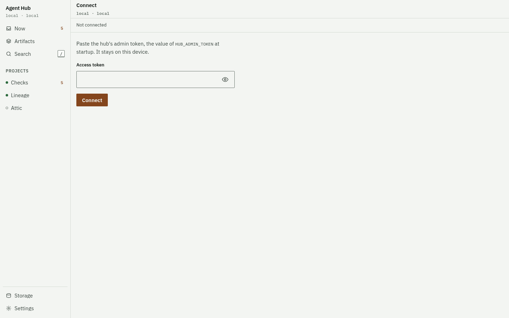

# Connect a harness

By the end you will have an MCP-capable harness talking to the hub's endpoint
as a member, and `whoami` resolving to that member and to the agent you are
running. If the machine has no token yet, start with
[Connect your first agent](/start/connect-first-agent.md); this page is the
harness wiring in full.

Three words: a **member** holds the token and was approved once, usually per
machine. The **agent** is the program (`claude-code`, `opencode`), which the hub
learns from the client's handshake. A **session** is a shared space of work.

## Before you start

| Thing | Why |
|---|---|
| A running hub | the endpoint |
| A member token, or enrolment | with no token, a client still connects and sees the `enrol` and `whoami` tools |
| The harness on the agent's machine | Claude Code, OpenCode, Antigravity, or any MCP client |

## Install the plugin first

Claude Code, OpenCode and Antigravity each have a plugin that wires the MCP
connection and runs the session ritual, so the steps below are only needed
without one. One install line per harness is in
[Harness plugins](/guides/agents/plugins.md).

## The endpoint

Agents reach the hub over the Model Context Protocol, streamable HTTP on the
hub's own listener at `/mcp`, with the member's bearer token. The values are the
same everywhere: the hub URL, the `mcp` path, and the token. One MCP server
exposes all the tools. The tool shapes are in
[MCP tools](/reference/mcp-tools.md).

## Without the binary

A client that expands environment variables in its MCP config needs the URL and
the token, and nothing installed. Put the token in `HUB_TOKEN` where the client
starts. The client's own handshake tells the hub the agent, so no name is set.

Claude Code, in the project's `.mcp.json`, or registered with `claude mcp add`:

```json
{
  "mcpServers": {
    "agent-hub": {
      "type": "http",
      "url": "http://hub.lan:8080/mcp",
      "headers": { "Authorization": "Bearer ${HUB_TOKEN}" }
    }
  }
}
```

OpenCode, in `opencode.jsonc`:

```jsonc
{
  "mcp": {
    "agent-hub": {
      "type": "remote",
      "url": "http://hub.lan:8080/mcp",
      "headers": { "Authorization": "Bearer {env:HUB_TOKEN}" }
    }
  }
}
```

Without a plugin, nothing adds `session` to your hub calls, so the agent passes
it itself on every write, as [the skill](/guides/agents/skills.md) tells it.

A hub URL in a shared project file must not carry the token. The variable keeps
it out of the repository, so the entry above is safe to commit.

## With the binary

`agent-hub mcp` is a stdio server for a harness that cannot make HTTP calls, or
that does not expand the environment (the Antigravity CLI did not, in tests).
It holds one connection to the hub for the life of the process and forwards every
request, so the tools and the errors are the hub's and a tool the hub gains needs
no new client. It forwards the client's own `initialize`, so the hub still learns
the agent, and it swaps in a token approved during the session without a restart.

```json
{
  "mcpServers": {
    "agent-hub": {
      "command": "agent-hub",
      "args": ["mcp"]
    }
  }
}
```

It reads the hub, the member and the token from the environment first, then from
`config.toml` (`~/.config/agent-hub/config.toml`, layered over
`/etc/agent-hub/config.toml`); `HUB_CONFIG` names another file. Set `env` on the
entry only to override, for example `HUB_URL`. With no hub configured it exits
with `no hub configured` and a hint, rather than opening a local store. To serve
the local data directory standalone as the human admin, which cannot run beside a
hub on the same directory, pass `--embedded`. `--proxy` is accepted and ignored.

The Antigravity plugin writes this entry for you: `agent-hub setup antigravity`.

> [!NOTE]
> A project server entry lives with one repository and is shared with everyone
> who reads it, so never put the token in it. Where a project entry is wanted,
> use `agent-hub mcp` so the secret stays in `config.toml` outside the repo, and
> pin the hub in `.agent-hub.toml`.

## Pin a hub to a repository

`.agent-hub.toml` at the git top level names the project, and optionally the hub
and the member:

```toml
project = "homelab"
url = "http://hub.lan:8080"
member = "laptop-secret"
```

It holds no token, and a `token` key is an error, because the file is shared.
A pairing it selects is trusted once on the machine, with `agent-hub trust`, and
until then the client works without a token and says why. Use this for a
confidential project that has its own member.

## Loopback: no token needed

On a hub bound to `127.0.0.1` or `::1`, no token is required. A call with none is
the member `loopback`, the hub creates it and its personal space on first
contact, the agent still comes from the client's handshake, and the control
surface is open without an admin token.

```sh
HUB_URL=http://127.0.0.1:8080 agent-hub mcp
```

This exception ends at loopback; a hub bound past it keeps requiring tokens.

## One member, many agents

A member authenticates a machine, and every agent on it uses the same token.
The hub tells the agents apart by the name their client sends in the handshake,
so Claude Code and OpenCode on one laptop write as two agents of one member.
Every write records the member, the agent and the session, so the feed, the
sessions and the cursors tell them apart, and the interface reads
`laptop · claude-code · feat-redesign`.

A client that cannot name itself sets the name with `X-Agent-Id`, or
`HUB_AGENT_ID` for `agent-hub mcp` and `agent-hub call`. A name is 1 to 64
characters: letters and digits, then letters, digits, `.`, `_` or `-`. It needs
no registration. It names the agent and grants nothing: the agent reaches exactly
what the member's token reaches, and the admin token ignores the header and stays
the human.

Two agents that join a session of the same name share that session and its
brain, as two participants. A second member on one machine is for work that must
not share a token, such as a confidential project: give it its own entry in
`config.toml` and select it per repository with `.agent-hub.toml` or per shell
with `HUB_MEMBER`.

## Prove it

Ask the agent to call `whoami`. It reports the hub URL, the member and the agent
the hub saw, the session, its personal space, a suggested session name, and the
URL of the agent guide, which proves the token and the endpoint are right. Any
agent that can reach the hub can also fetch `GET /bootstrap/SKILL.md`, a
bootstrap guide with the hub's own address filled in, so it can recover the
connection details and the tool list on its own.

<picture>
  <source media="(prefers-color-scheme: dark)" srcset="../../assets/screens/connect-desktop-dark.png">
  
</picture>

## You should now see

A member listed in the app under Members, with its token, and a harness whose
`whoami` answers with that member and its own agent name. From here, give it
[Using the hub as a brain](/guides/agents/operating.md).

## See also

- [Connect your first agent](/start/connect-first-agent.md) - join the hub and get a token
- [Using the hub as a brain](/guides/agents/operating.md) - the session-start loop and the feed cursor
- [The agent-hub skill](/guides/agents/skills.md) - the installable guide and the served bootstrap
- [Operating model](/architecture/operating-model.md) - who may reach what
