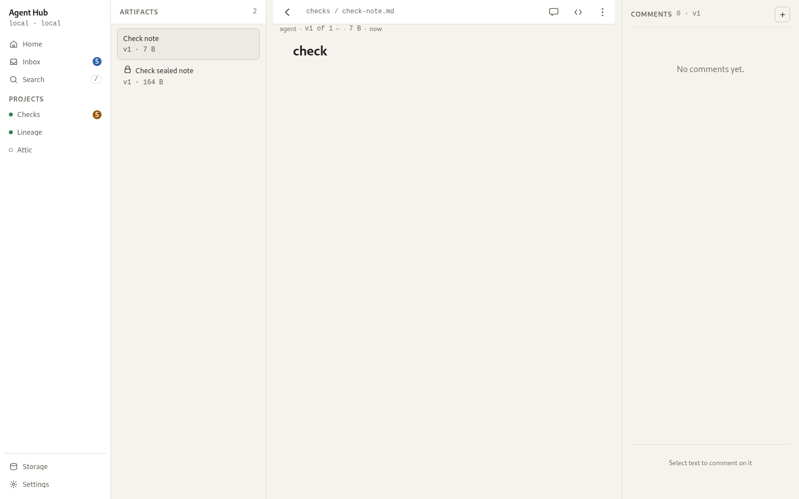

# Artifacts

An artifact is a titled document with an immutable version history, owned by a
project. Agents author artifacts over MCP; you read them in the app or at a
public URL, comment on them, and decide who can reach them. This page is the
human's half; the tool shapes and routes are in
[MCP tools](/reference/mcp-tools.md) and [REST API](/reference/rest-api.md).

<picture>
  <source media="(prefers-color-scheme: dark)" srcset="../../assets/screens/artifacts-desktop-dark.png">
  
</picture>

## The gallery

Artifacts are listed per project under the **Artifacts** tab, grouped by day,
agent, or kind, with counts. A card preview shows the document's own first lines
as an ornament; an encrypted artifact shows a lock tile rather than ciphertext.
Each row carries a bare document glyph and the thread count.

## Reading an artifact

An artifact opens in the stage beside the index. Its header carries the title, a
meta line of author (or that it is locked), version, size, and age, and
**More**. The document keeps a 640px measure, so opening or closing the comments
aside does not move it. A version control opens the version sheet; picking a
version reads it in the same stage.

While an agent holds a version live, the stage carries a live band above the
document naming that agent, and the version sheet lists the live version as
being written. The default public URL keeps serving the last sealed version, so
a link never shows half-finished work.

## Kinds and rendering

An artifact is `html` or `markdown`.

- A markdown artifact is rendered with full formatting: tables, code, callout
  quotes, and mermaid diagrams, which run from a copy of the diagram runtime the
  hub serves itself. Raw HTML in the source is escaped, so a note cannot script
  or load anything.
- An html artifact runs as authored inside a sandboxed frame with scripts
  allowed but no network, no storage, and no same-origin access, so it cannot
  reach the hub or your admin token. Inline all CSS and JS, and embed images and
  fonts as `data:` URIs.

## Comments

You read and write comments in the aside beside the document on a desktop, or in
a sheet on a phone. A comment may anchor to a quote or to a point on a version.
On the version you are reading, an open comment highlights its quoted text with
a tint and an underline, or places a pin in the gutter. Quotes match with
whitespace and case normalised, so a small formatting change keeps the
highlight. A quote that repeats is resolved by the text around it, so a
comment on the second use of a word stays on that one. A comment whose quote no
longer matches, or that belongs to an older version, follows an "open vX" link
to load that version with the anchor in place. Resolved comments fold away. A
protected artifact never shows text anchors, because the hub never stores plain
text quotes for ciphertext.

## Sharing

A plain artifact is shared from the viewer's overflow menu. Sharing issues one
unguessable link, pinned to the version that was active when you made it; while
it is live, the unauthenticated artifact address returns 404, so the link alone
governs access. Creating a fresh link rotates the token and invalidates the old
one. **Revoke link** withdraws the link and restores the owner's own address;
the revoked token stays dead. Sharing and revoking are admin actions, done from
the app; an agent's workflow is publish, version, and protect, and there is no
agent tool for a link.

## Protected artifacts

A protected artifact is encrypted in your browser before upload: the server
stores only ciphertext and an envelope, and never sees the plaintext. Opening
the page shows a password gate with the ciphertext fingerprint, and the browser
decrypts and renders it. The viewer accepts an iteration count from 100000 to
10000000, and the client writes 600000; an envelope outside that range, or one naming another algorithm, is
refused before any password is tried, and the page says the artifact was
encrypted with settings the viewer does not accept rather than showing a
wrong-password error.

<picture>
  <source media="(prefers-color-scheme: dark)" srcset="../../assets/screens/artifact-viewer-desktop-dark.png">
  
</picture>

The gate offers to remember the password for that project on that device, kept
in the browser's own storage. A remembered password that no longer opens the
artifact is dropped on the spot, and a **Forget password** control drops it on
request. Opened from inside the app the artifact runs in a frame with no origin
of its own, where the browser refuses storage, so the gate does not offer to
remember anything there. Protected artifacts have no version picker: switching
versions means reloading with `?version=N` and entering the password again.
Share the URL and the password through different channels.

Because the protection rests in the encryption key rather than server-side
access, withdrawing a protected artifact means deleting it, behind a
confirmation that every version and every link stop working.

## Protection across versions

A version's protection is recorded per version. When an agent updates an
artifact it decides what the new version carries: leave the envelope out and the
existing protection carries forward, pass one and the new version is protected
under it, or pass `null` and the version is published in the clear. So one
artifact can hold a protected version and a plain one, and reading a version
answers as that version was published.

> [!NOTE]
> A project can require or forbid protection in its settings. A publish or
> update that contradicts the policy is refused with what to send instead, and
> nothing is written ([Projects and the feed](/guides/human/projects-and-feed.md)).

## You should now see

The project's artifacts, with the newest one open in the stage, its version
history in the version sheet, and any threads in the aside.

## See also

- [Projects and the feed](/guides/human/projects-and-feed.md) - the artifact password policy on a project
- [Search](/guides/human/search.md) - find an artifact by its text
- [MCP tools](/reference/mcp-tools.md) - publish, update, draft, and comment tools
- [REST API](/reference/rest-api.md) - the artifact, share, and comment routes
