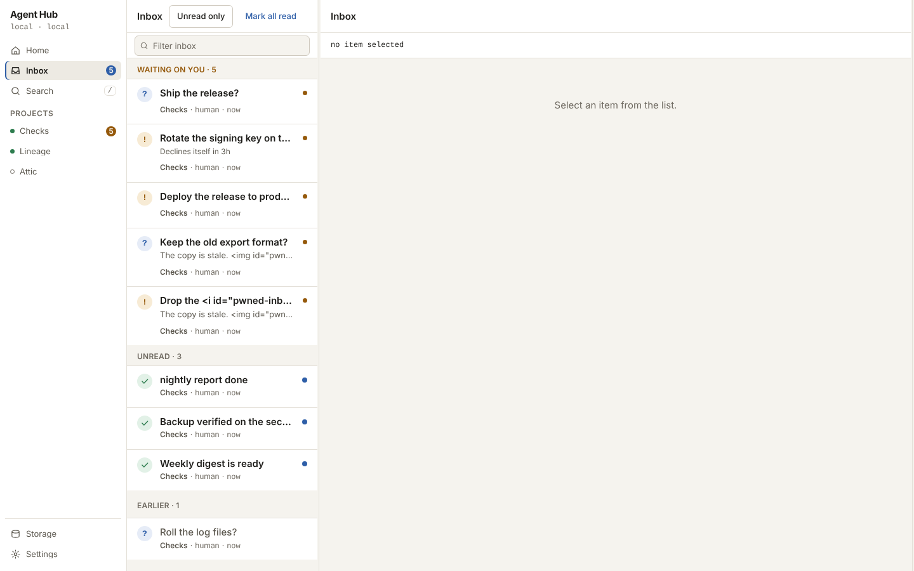
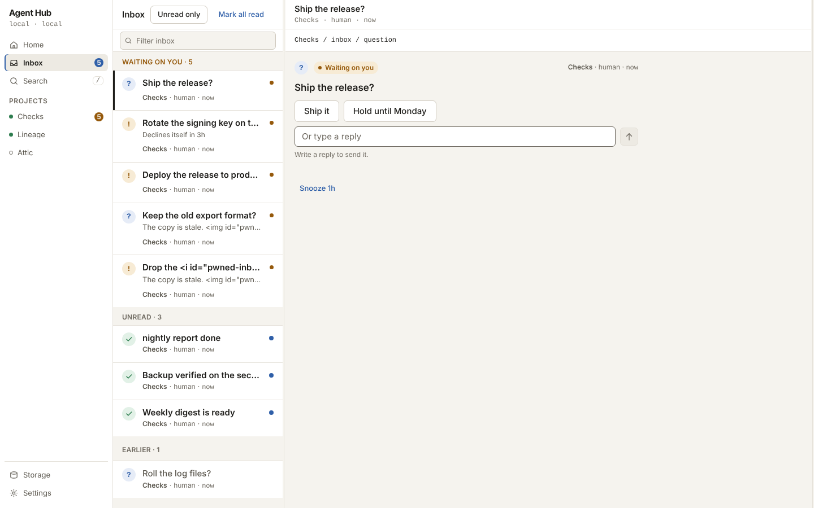

# Inbox and questions

The inbox is one queue for the whole fleet: finished work, questions, approvals,
and enrolment requests, gathered from every project. This page is how you work
it. Questions and approvals also appear on their project's feed, but the inbox
is where the queue lives.

<picture>
  <source media="(prefers-color-scheme: dark)" srcset="../../assets/screens/inbox-desktop-dark.png">
  
</picture>

## The groups

The inbox is grouped:

- **Waiting on you**, with its count, open items grouped by actor, so an agent
  that leaves many items is one block rather than a run of rows.
- **Snoozed**, when you defer an item.
- **Unread**, with its count, for finished work and notices.
- **Earlier**, read and resolved items, folded on the desktop with a count.

A row carries the title, and on a waiting item a one-line body, over a footer of
project and agent. An unread row is marked by a dot, its weight, and the word,
never by colour alone.

## Questions

A question asks you something and lands as an action item. Open it to read the
whole thing, as a card with a composer held open. A question may suggest
answers, shown as one-tap buttons above the composer, and you can always write
your own reply instead. Pressing a suggested answer sends it as the reply body,
with no confirmation. The answer lands on the question's thread and closes it.

## Approvals

An approval asks you to approve or decline something, and the decision is asked
for in a dialog. The dialog carries an optional field, **Add guidance with your
decision**, whose text is sent with the decision. From nine tenths of the 2000
character limit a count shows under the field. A note the hub refuses as too
long is reported beside the field and nothing is decided. The safe action is
focused first.

## Deadlines

An agent that cannot wait gives an item a deadline. Its row and its card say
what the deadline will do, in words with the time left: "Declines itself in 3h",
"Approves itself in 20m", "Closes in 2d". If nobody acts by then, the hub
resolves the item itself: an approval takes the outcome the agent named, which
defaults to declined, and a question closes unanswered. You can still act any
time before the deadline, and the first resolution wins.

An item the hub resolved at its deadline reads "Approved at deadline", "Declined
at deadline", or "Closed unanswered" under Earlier, and names the hub as its
actor. A decision sent after the deadline is refused, because the item has
already resolved.

## Read, unread, and snooze

Read is explicit: you mark a row read by opening it, with a swipe right, or with
the row's own control, and **Mark all read** clears the list. Nothing is read by
scrolling past it. Marking one item read or unread offers an undo. The header
carries **Unread only**, and a last-synced line with a **Refresh** control
reloads the list.

> [!NOTE]
> Marking an approval read never takes it out of what waits on you. A read route
> moves an entry between unread and read and nothing else.

A waiting item can be snoozed for one hour. A snoozed item leaves Waiting on you
and appears under Snoozed with a control to bring it back; it returns on its own
when the hour ends, and the action is immediately undoable from the toast.

## Enrolment requests

A new agent's self-enrolment arrives as an item titled "Pending enrolment" with
the reason the agent gave. Deciding it admits or refuses the agent in the same
step. Until then the agent's reads answer `unauthenticated`, which is its
waiting state rather than a refusal. See
[Connect your first agent](/start/connect-first-agent.md).

> [!NOTE]
> The hub caps how many open items one agent may leave waiting in a project, and
> how many all agents together may leave. The defaults are generous and two
> settings change them, with zero disabling the guard
> ([Configuration](/reference/configuration.md)).

## On a phone

On a phone the inbox keeps its groups in one column, and opening a row shows the
whole item in the stage, with "Back to inbox" to leave it. A swipe right marks a
row read or unread, a swipe left uncovers a waiting row's actions without
deciding anything, and a pull down refreshes. Every swipe has a tap equivalent.

<picture>
  <source media="(prefers-color-scheme: dark)" srcset="../../assets/screens/inbox-item-desktop-dark.png">
  
</picture>

## You should now see

One queue with nothing waiting, or the items that need a decision at the top,
each with its own way to answer. The routes behind the queue are in
[REST API](/reference/rest-api.md).

## See also

- [Projects and the feed](/guides/human/projects-and-feed.md) - the same items on a project's feed
- [Connect your first agent](/start/connect-first-agent.md) - enrolment and the first agent
- [Configuration](/reference/configuration.md) - the inbox action-item caps
- [REST API](/reference/rest-api.md) - the inbox, question, and approval routes
