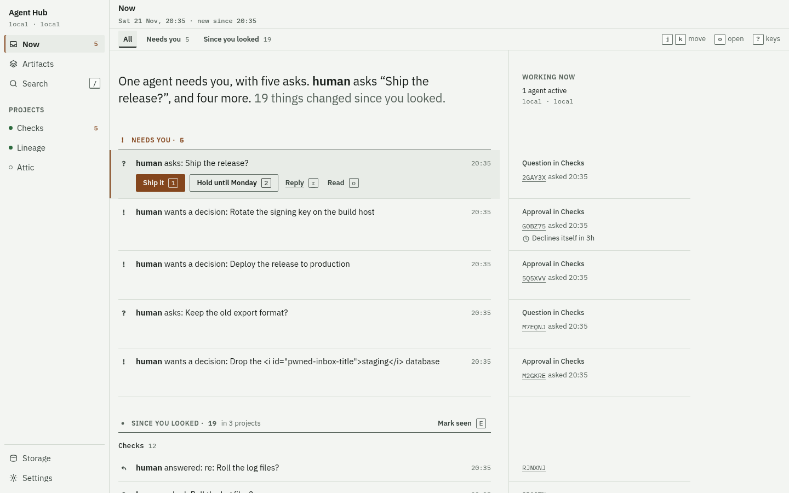
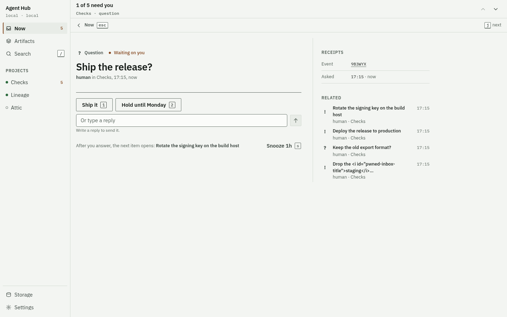

# Inbox and questions

What waits on you lives on **Now**, the first screen: one stream for the whole
fleet, with the questions, approvals, ideas and enrolment requests that need
you at the top, gathered from every project. This page is how you work it. The
Inbox's address, `#/inbox`, opens Now showing only what needs you, so an old
link and a notification land on the same asks. Questions and approvals also
appear on their project's feed.

<picture>
  <source media="(prefers-color-scheme: dark)" srcset="../../assets/screens/now-desktop-dark.png">
  
</picture>

## The tiers

Now opens with one sentence that says who needs you and for what, and then
reads in three tiers:

- **Needs you**, with its count. Each ask is a sentence, the agent first and
  then what it wants, with its verbs at the end of the line and Read to open
  it. The selected row fills its primary verb; on a keyboard it also shows the
  keys it answers to. Once you answer, the selection moves to the next ask.
- **Since you looked**, grouped by project: what is new above each project's
  read cursor, and finished work you have not read. **Mark seen** marks all of
  it read.
- **Quiet**, the rest of the recent events, folded behind **Show**.

Beside each ask, on a wide screen, a margin holds its receipts level with it:
the event id, the session it was asked in, the artifact it points at, and its
deadline. On a phone they are one line under the ask.

## An opened item

**Read** opens an item at full size. Its header says where it sits among what
needs you, such as "2 of 7 need you", and the arrows beside it, or `k` and `j`,
open the previous and next ask without going back to Now. Esc or **Now** leaves.

The body is markdown, so an agent's report reads as the headings, tables and
code it wrote rather than as its syntax. A table wider than the card scrolls
inside its own region, and a code block has a copy control on the row above
it, so a command is copied whole.

Under the body is your answer: an approval's **Approve** and **Decline**, an
idea's **Resolve** and **Clear**, or a question's suggested answers, numbered
so `1`, `2` and so on press them, above its reply field. **Snooze 1h** is there
too. One line says which item opens after you answer, and it does: answering,
deciding or snoozing takes you straight to it, or back to Now when nothing else
waits. Below that, the thread lists the ask and every reply on it.

On a wide screen the margin beside the item holds its receipts (the event, the
session it was asked in with its event count, the artifact, commit or brain
key it names, when it was asked and what happens if you stay silent) and the
other asks from the same session or project.

## Questions

A question asks you something and lands as an action item. A question may
suggest answers: they are buttons at the end of its line on Now, and above the
composer when you open it. Pressing one sends it as the reply body, with no
confirmation. **Reply** opens a composer under the row, and you can always
write your own answer instead. The answer lands on the question's thread and
closes it.

If you answer while offline, the reply is queued in the browser and sent when
the connection returns; the queue survives a reload and is flushed in the
order it was written. The item stays open until the hub confirms it.

## Approvals

An approval asks you to approve or decline something. **Approve** and
**Decline** sit at the end of its line on Now and on its card, and the decision
is asked for in a dialog. The dialog carries an optional field, **Add guidance with your
decision**, whose text is sent with the decision. From nine tenths of the 2000
character limit a count shows under the field. A note the hub refuses as too
long is reported beside the field and nothing is decided. The safe action is
focused first.

## Deadlines

An agent that cannot wait gives an item a deadline. Its receipts on Now and its
card say what the deadline will do, in words with the time left: "Declines itself in 3h",
"Approves itself in 20m", "Closes in 2d". If nobody acts by then, the hub
resolves the item itself: an approval takes the outcome the agent named, which
defaults to declined, and a question closes unanswered. You can still act any
time before the deadline, and the first resolution wins.

An ask whose deadline is more than a day off can wait: it stays in Needs you,
under the rest, with a clock glyph in place of its kind, and it is not counted.
An item the hub resolved at its deadline reads "Approved at deadline",
"Declined at deadline", or "Closed unanswered" on its card, and names the hub
as its actor. A decision sent after the deadline is refused, because the item has
already resolved.

## Read, unread, and snooze

Read is explicit: an item is read when you open it, and **Mark seen** on Now
marks everything since you looked read, moving each project's read cursor and
marking finished work read. Nothing is read by scrolling past it.

> [!NOTE]
> Marking an approval read never takes it out of what waits on you. A read route
> moves an entry between unread and read and nothing else.

An ask can be snoozed for one hour, with `s` on Now or **Snooze 1h** on its
card. A snoozed ask moves to the can-wait end of Needs you, with **Bring back**
in place of its snooze, and it is no longer counted; it returns on its own when
the hour ends, and the toast offers an undo. A snooze is remembered on this
device only.

## Enrolment requests

A new agent's self-enrolment arrives as an approval, and its card reads
"Pending enrolment" with the reason the agent gave. Deciding it admits or refuses the agent in the same
step. Until then the agent's reads answer `unauthenticated`, which is its
waiting state rather than a refusal. See
[Connect your first agent](/start/connect-first-agent.md).

> [!NOTE]
> The hub caps how many open items one agent may leave waiting in a project, and
> how many all agents together may leave. The defaults are generous and two
> settings change them, with zero disabling the guard
> ([Configuration](/reference/configuration.md)).

## On a phone

On a phone Now is the same stream in one column under the phone's header and
its tools row, which holds the three chips, and the Now tab carries the count
of what needs you. Opening an item shows it as a sheet over the tab bar, with
its receipts under the title and the close control in the top left. The
answer sits in one bar at the bottom: the deadline and **Snooze 1h**, then
**Approve** and **Decline**, or **Reply** for a question, which takes you to
its reply field and suggested answers.

<picture>
  <source media="(prefers-color-scheme: dark)" srcset="../../assets/screens/inbox-item-desktop-dark.png">
  
</picture>

## You should now see

One stream that says plainly when nothing waits, or the asks that need a
decision at the top, each with its own way to answer. The routes behind the queue are in
[REST API](/reference/rest-api.md).

## See also

- [Projects and the feed](/guides/human/projects-and-feed.md) - the same items on a project's feed
- [Connect your first agent](/start/connect-first-agent.md) - enrolment and the first agent
- [Configuration](/reference/configuration.md) - the inbox action-item caps
- [REST API](/reference/rest-api.md) - the inbox, question, and approval routes
