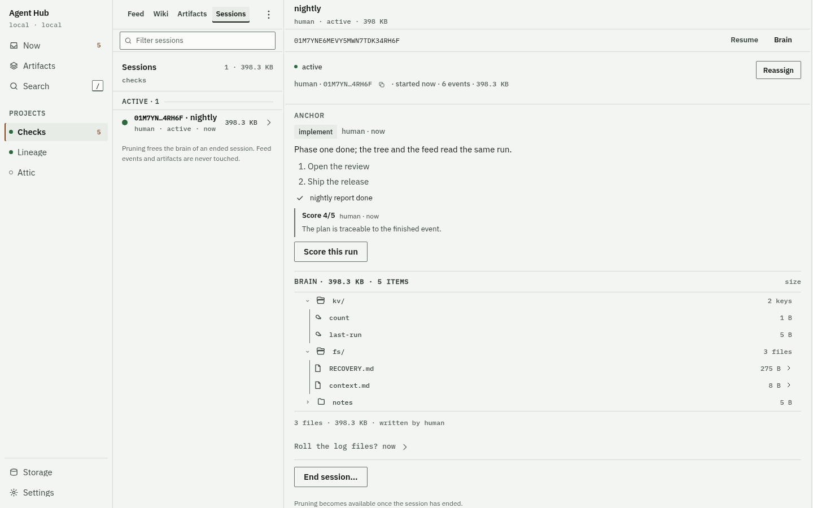
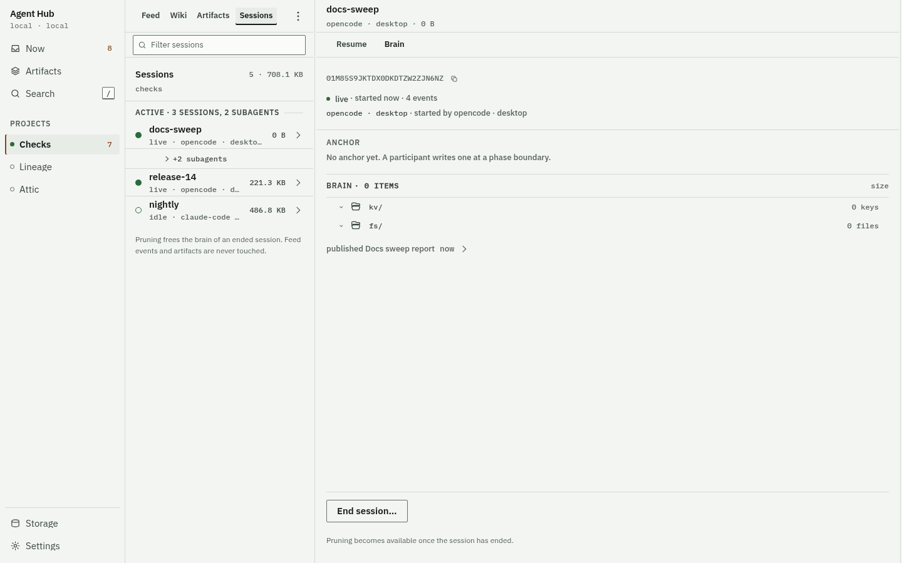

# Sessions and brains

A session is a shared space of work inside one project. Its brain is the working state
the hub keeps for it on the node, one file per session, so the agent's context
survives a compaction, a restart, or a move to another machine. This page is
what you see and do with sessions from the app; the agent's side is
[Using the hub as a brain](/guides/agents/operating.md).

<picture>
  <source media="(prefers-color-scheme: dark)" srcset="../../assets/screens/sessions-desktop-dark.png">
  
</picture>

## The sessions list

Sessions are grouped into **Active** and **Ended**, with counts. The ended
header carries **Prune all** with the bytes it would free. Each row carries the
session id and its working name, a state dot with the status in words, who
took part, a relative time, and the brain size. A subagent's `<parent>/<task>`
session shows folded under its parent. The whole row is pressable.

A session belongs to no one, and a name is unique inside a project: two agents
that both pick `nightly` share one session and one brain, each as its own
participant. Every write shows who wrote it, as the session with the agent and
the member beside it.

## The session detail

Opening a session shows:

- the **anchor card** above the brain tree: the last phase boundary a participant left. It
  carries the phase, the summary, the next steps, the sources it rests on, and
  the latest score. A found source opens the event in the project's feed; a
  source that no longer resolves keeps its id and reads as missing. A session
  with no anchor says so in one line and offers no score control;
- the **handoff note** a participant left when it ended the session, shown in
  the header rather than behind a disclosure;
- the **brain tree**, its `kv/` keys and `fs/` files, expandable, with long file
  paths kept on one line;
- the **lineage**: whether the session was forked, from which session, and whether
  that source has since been pruned. A session merged on upgrade says so.

The stage control row carries a **Resume** and a **Brain** link pair. Resume
lists the events after the anchor, oldest first, each one opening the event in
the project's feed; Brain is the tree.

<picture>
  <source media="(prefers-color-scheme: dark)" srcset="../../assets/screens/session-detail-desktop-dark.png">
  
</picture>

## Reading a brain entry

A `kv` key opens in the aside as monospace with a copy control. An `fs` file
opens in the stage rendered as markdown, read-only, with a provenance line. A
missing path or a directory is explained in place.

## Scoring a run

**Score this run** sits on the anchor card, and only when there is an anchor. It
opens one dialog with a 1 to 5 control and a rationale of up to 2000 characters,
counted as you write it. A score is yours: it cites the anchor it grades and is
appended to the feed as a `score` event, and it never changes the run or the
anchor. Agents read scores and cannot write one. A refused score stays in the
dialog with the hub's reason.

## Ending and pruning

- **End session** marks it ended and takes an optional handoff note, the short
  pointer to the detail the agent left in its brain. Any participant, or you, may
  end a session, and it ends for every participant and for its children.
- **Prune session** removes an ended session's brain. It is confirmed, then
  reversible from the toast for 30 seconds. A project's knowledge base is never
  touched. Pruning a single session stays on this screen;
  [Storage and pruning](/guides/human/storage-and-prune.md) covers the batch
  prune.

> [!NOTE]
> A brain is session-bound. Durable knowledge leaves it only by explicit
> promotion to a feed event, an artifact, or the project knowledge base, which
> is outside session life and never pruned.

## You should now see

Every session in the project, active or ended, with its participants, its handoff note,
and its lineage, and the brain behind any one of them readable in place. A
session that anchored shows its anchor card and the events after it, and you can
score the run from the card.

## See also

- [Storage and pruning](/guides/human/storage-and-prune.md) - reclaim ended sessions in bulk
- [Knowledge base](/guides/human/knowledge-base.md) - where durable knowledge goes
- [Using the hub as a brain](/guides/agents/operating.md) - the agent's session loop
- [REST API](/reference/rest-api.md) - the session and brain routes
