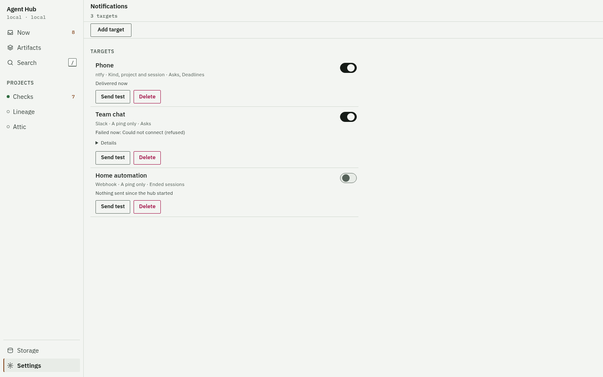

# Notifications

By the end you will have the hub sending a notice to a service you use whenever
an agent asks you something, with the app closed. The interactive alert model
is in [Human interface](/design/human-interface.md).

## Before you start

| Thing | Why |
|---|---|
| A service that takes a webhook | the hub sends to a URL; it does not host one |
| The admin token, or the app on the hub's own machine | targets are added on the control surface |
| `public_url` set, for links | a notice links back only when the hub knows its own address |

## Why there is no push

An installed app that is fully closed raises nothing on its own. Background push
notifications are deferred ([ADR 0016](/adr/0016-push-notifications-deferred.md)):
while the app is open it reads a freshness stream and refreshes its waiting
badge, with a slow poll as the fallback, but with the app fully closed nothing
is raised. A notify target is the opt-in exception
([ADR 0026](/adr/0026-contentless-notify-target.md),
[ADR 0040](/adr/0040-notify-targets-with-content-levels.md)). With no target,
nothing is sent.

## Add a target

Open **Settings**, then **Notifications**, and choose **Add target**. Pick the
service, paste its URL, choose what it sends and when, and add it. Then press
**Send test** on its row: the row says whether the service took it, and why not
if it did not.

<picture>
  <source media="(prefers-color-scheme: dark)" srcset="../assets/screens/notifications-desktop-dark.png">
  
</picture>

| Service | URL to paste | Token field |
|---|---|---|
| Webhook | any `http` or `https` URL | sent as `Authorization: Bearer` |
| ntfy | `https://ntfy.lan/<topic>` | an ntfy access token, as Bearer |
| Gotify | `https://gotify.lan/message` | the application token |
| Matrix | `https://<homeserver>/_matrix/client/v3/rooms/<room id>/send/m.room.message` | the bot's access token |
| Slack | the incoming webhook URL, `https://hooks.slack.com/services/...` | none: the URL is the secret |
| Discord | the channel webhook URL, `https://discord.com/api/webhooks/...` | none |
| Telegram | `https://api.telegram.org/bot<token>/sendMessage?chat_id=<chat>` | none |
| Pushover | `https://api.pushover.net/1/messages.json?token=<app>&user=<user key>` | none |

Slack's shape also suits Mattermost and Rocket.Chat incoming webhooks.

> [!IMPORTANT]
> Moving a target's URL to another host drops its token unless you give it
> again, so a token is never sent to a host it was not given for.
> The URL and the token are stored in the hub's database and never shown again:
> the app and the API show the URL's origin and whether a token is set, and the
> log names the origin only. Both are in every backup of `hub.db`.

## Choose what it says

| Level | A notice carries | Default for |
|---|---|---|
| A ping only (`none`) | one fixed sentence, such as `Something is waiting for you in Agent Hub.` | every service but Gotify |
| Kind, project and session (`title`) | `Question waiting in Zebra launch · nightly`, and a link to the item | Gotify, which is always your own server |
| The question text too (`full`) | as above, and the question or approval text | none |

- A **confidential project** is always sent as a ping, whatever the level,
  checked again just before each send.
- An **enrolment request** never carries the requester's text, its name or its
  reason, at any level: the caller holds no token yet.
- Agent text is sent as plain text. Slack-shaped bodies escape `&`, `<` and
  `>` and break bare `@` mentions, Discord escapes Markdown and allows no
  mentions, Matrix sends an empty mention set, and markdown is never switched
  on.
- No session brain, knowledge base page, artifact or handoff note is ever sent.
- Slack, Discord, Telegram and Pushover are vendor clouds. Raising one above a
  ping puts project names, and at `full` the text of an ask, on that vendor's
  servers; the dialog says so when you choose it.
- The link is `public_url` followed by `/id/<id>`, the item's short address.
  Without `public_url` a notice has no link.

## Choose when it sends

| Event | Sent when | Default |
|---|---|---|
| Asks | a question, an approval, an idea or an enrolment request starts waiting | on |
| Deadlines | an open item with a deadline has ten minutes left, or half its window if that is shorter; once per item | on |
| Ended sessions | an agent ends a session | off |

A retried write that the hub answers from its idempotency key sends nothing.

## How it is sent

- **Off the write path.** The agent's write returns before anything is sent.
- **Rate-limited per target.** At most one send per `notify_interval_secs`
  (default 60). What arrives inside the quiet period is one trailing send, which
  at `title` or `full` reads `3 updates in Agent Hub`.
- **Deduplicated.** A target drops a notice it has already queued or recently
  sent for the same event and item.
- **Retried, a little.** A send that times out (10 seconds), cannot connect, or
  is answered 429 or 5xx is tried twice more, 2 and 10 seconds apart. Any other
  answer is final.
- **Reported.** Each row shows the last delivery or the last failure and its
  cause. The status starts empty when the hub restarts. Every send is counted in
  `agenthub_notify_sends_total` by result, and a failure is logged at warn.

## The configured target

The setting from earlier versions still works and is listed first, as
`config.toml`. It sends a ping for asks only, as plain text, and is changed in
the configuration rather than in the app:

```toml
[hub]
notify_url = "https://ntfy.lan/agent-hub?title=Agent+Hub&click=https://hub.lan"
notify_token = "tk_..."
notify_interval_secs = 60
```

The equivalent environment variables are `HUB_NOTIFY_URL`, `HUB_NOTIFY_TOKEN`
and `HUB_NOTIFY_INTERVAL_SECS`. `notify_url` may not carry credentials; use
`notify_token`. `notify_interval_secs` sets the quiet period of every target.

## From a script

The admin routes are in [REST API](/reference/rest-api.md#notify-targets):

```sh
curl -X POST "$HUB_URL/api/v1/notify/targets" -H "Authorization: Bearer $HUB_ADMIN_TOKEN" \
  -H 'Content-Type: application/json' \
  -d '{"name":"Phone","preset":"ntfy","url":"https://ntfy.lan/agent-hub","content":"title"}'
```

A webhook target receives a stable JSON body. A key the level withholds is
absent:

```json
{"version":1,"event":"ask","text":"Question waiting in Zebra launch · nightly",
 "at":"2026-11-26T10:00:00Z","kind":"question","project":"zebra-launch",
 "project_name":"Zebra launch","session":"nightly","id":"01J...",
 "url":"https://hub.lan/id/01J...","summary":"Ship the nightly build?"}
```

`event` is `ask`, `deadline`, `ended` or `test`. A deadline notice adds
`due_in_minutes`, and a trailing send that stands for several adds `count`.

## Not in scope

Answering or approving from a chat service, routing by project, your own message
templates, email, and Web Push.

## You should now see

With the app closed, a question an agent asks reaches your service, and the
target's row in **Notifications** reads `Delivered` with the time.

## See also

- [Monitoring](/operate/monitoring.md) - the notify counter and its failed result
- [Configuration](/reference/configuration.md) - `notify_url`, `notify_token`, `notify_interval_secs`
- [Human interface](/design/human-interface.md) - the in-app alert states
