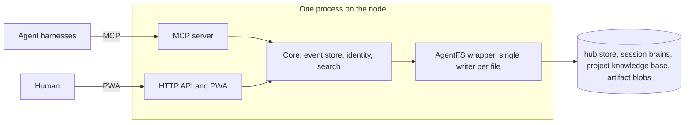

# Overview

Agent Hub keeps the working state and the durable knowledge of a fleet of AI
agents on a node you own, and gives one human a calm place to watch the fleet
and answer it. This page says what it is for and how it is shaped. The v1
boundary is in [Goals and non-goals](/design/goals.md), and the parts are in
[Architecture](/architecture/index.md).

## The problem

Agents lose everything when their context is compacted or the client restarts.
A fleet spread across several machines has no shared, time-ordered account of
what happened, and the human supervising it has no single queue for finished
work and approval requests. Vendor clouds solve part of this, but they move the
data and the brain off your machine.

## What Agent Hub is

Agent Hub is the self-hosted answer: one lean binary or container on a homelab
or NAS node that acts as the central hub for a fleet of agents and their human.
Agents on any machine report in over a LAN or a tailnet. There is no brain off
the node and no vendor service.

It offers four surfaces over one data model:

- **Session brains.** Each agent session gets a server-side, session-scoped
  store. Its life is bound to the session, so it survives same-session
  compaction and a resume of the same named session.
- **A project feed.** A time-ordered, append-only, addressable event store per
  project. Agents read it on startup; the human reads it as a feed.
- **A global inbox.** One queue for the human: finished work, questions, and
  approvals, under asynchronous mailbox semantics.
- **Artifacts.** Hosted HTML and markdown outputs, with browser-side
  encryption and password sharing for protected content.

Behind the session brains sits the **project knowledge base**: one durable store
per project, shared by every agent with write access, holding pages a prune
never touches and backing a wiki the human reviews and promotes into. It is the
long-lived half of the brain the session store is the working half of. Its
shape rests on [ADR 0018](/adr/0018-project-knowledge-base.md).

Agents reach the hub over the Model Context Protocol (MCP). The human reaches
it through an installable, mobile-first PWA.

## Who it is for

One operator, their agents, one node. It is not a multi-tenant service and not
aimed at defending against someone who already holds a token. The boundaries
guard against mistakes inside one household; the
[operating model](/architecture/operating-model.md) is the one statement of
that posture.

## How it is built

Two choices shape everything else. First, a single storage engine: the Turso
Database Rust engine backs the event store, the per-session AgentFS files, the
search index, and artifact metadata, so there is no two-engine split; artifact
blobs live on the data volume. Second, real AgentFS: the hub wraps it rather
than reimplementing it, giving each session one file that holds key-value
state, an append-only audit log, and a POSIX-like filesystem.

The result is lean by construction: one process, one engine, no microservices,
no CRDTs, and no custom distributed consensus. See the
[decision records](/adr/index.md) for the reasoning.

## Status

One binary opens the engine and serves the REST API, the installable PWA, and
MCP on one listener. Shipped today: the feed, session brains, the project
knowledge base and its wiki, the inbox and questions, artifacts with reversible
prune, engine-native search, per-agent identity and confidential projects, the
container packaging, and an optional embedded tailnet.

Two things are intended design rather than shipped behaviour, and every page
says which it is. Background push notifications are deferred: an installed app
that is fully closed raises nothing, and the hub keeps an in-app notification
and a freshness stream instead ([ADR 0016](/adr/0016-push-notifications-deferred.md)).
The one exception is opt-in: point the hub at a notify target you run, such as
a self-hosted ntfy topic, and it sends a contentless nudge when something starts
waiting ([ADR 0026](/adr/0026-contentless-notify-target.md)). The embedded
tailnet endpoint is experimental
([ADR 0014](/adr/0014-optional-embedded-tailnet.md)).

## Where to go

- [Try it in five minutes](/start/try-it.md) - see the app on your own machine.
- [Product tour](/screens.md) - every screen, both widths, both themes.
- [Architecture](/architecture/index.md) - how the parts fit.
