# Product tour

Every screen of the human surface, captured from a seeded hub with dummy data
at 1440x900 and 390x844 in both themes. Each pair follows your colour scheme.
The captures are a committed artifact: the `capture-wiki-screenshots` skill
refreshes them when a screen changes, and each is looked at before it lands.
The pages under [Guides](/guides/index.md) explain what each screen does.

## Home and the shell

### Home, desktop

<picture>
  <source media="(prefers-color-scheme: dark)" srcset="assets/screens/home-desktop-dark.png">
  
</picture>

### Home, phone

<picture>
  <source media="(prefers-color-scheme: dark)" srcset="assets/screens/home-phone-dark.png">
  
</picture>

## The inbox

### Inbox, desktop

<picture>
  <source media="(prefers-color-scheme: dark)" srcset="assets/screens/inbox-desktop-dark.png">
  
</picture>

### Inbox, phone

<picture>
  <source media="(prefers-color-scheme: dark)" srcset="assets/screens/inbox-phone-dark.png">
  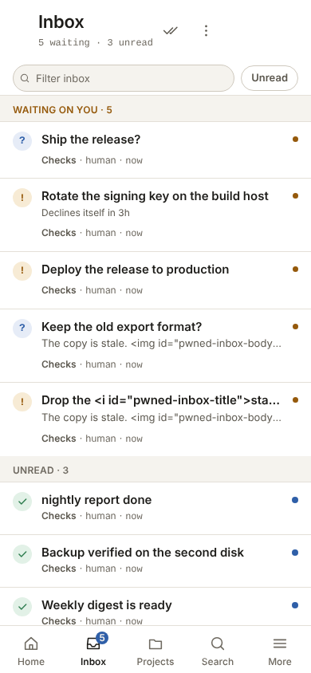
</picture>

### An open inbox item, desktop

<picture>
  <source media="(prefers-color-scheme: dark)" srcset="assets/screens/inbox-item-desktop-dark.png">
  
</picture>

### An open inbox item, phone

<picture>
  <source media="(prefers-color-scheme: dark)" srcset="assets/screens/inbox-item-phone-dark.png">
  
</picture>

## Projects and the feed

### Projects, desktop

<picture>
  <source media="(prefers-color-scheme: dark)" srcset="assets/screens/projects-desktop-dark.png">
  
</picture>

### Projects, phone

<picture>
  <source media="(prefers-color-scheme: dark)" srcset="assets/screens/projects-phone-dark.png">
  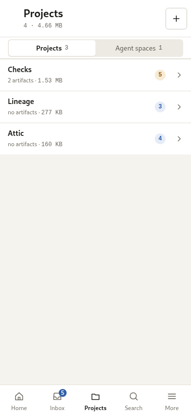
</picture>

### Project feed, desktop

<picture>
  <source media="(prefers-color-scheme: dark)" srcset="assets/screens/feed-desktop-dark.png">
  
</picture>

### Project feed, phone

<picture>
  <source media="(prefers-color-scheme: dark)" srcset="assets/screens/feed-phone-dark.png">
  
</picture>

## Sessions and brains

### Sessions, desktop

<picture>
  <source media="(prefers-color-scheme: dark)" srcset="assets/screens/sessions-desktop-dark.png">
  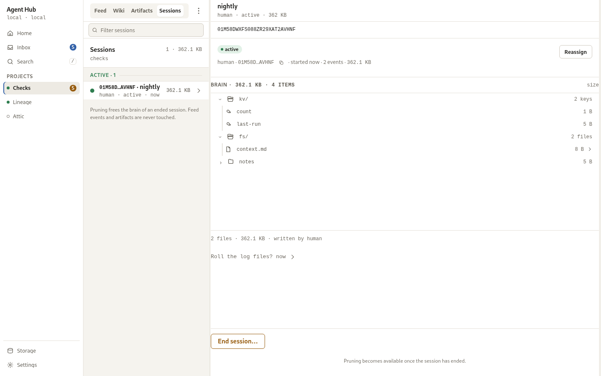
</picture>

### Sessions, phone

<picture>
  <source media="(prefers-color-scheme: dark)" srcset="assets/screens/sessions-phone-dark.png">
  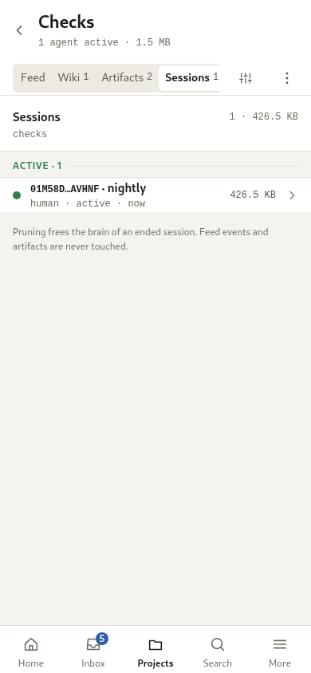
</picture>

### Session detail, desktop

<picture>
  <source media="(prefers-color-scheme: dark)" srcset="assets/screens/session-detail-desktop-dark.png">
  
</picture>

### Session detail, phone

<picture>
  <source media="(prefers-color-scheme: dark)" srcset="assets/screens/session-detail-phone-dark.png">
  
</picture>

## Artifacts

### Artifacts, desktop

<picture>
  <source media="(prefers-color-scheme: dark)" srcset="assets/screens/artifacts-desktop-dark.png">
  
</picture>

### Artifacts, phone

<picture>
  <source media="(prefers-color-scheme: dark)" srcset="assets/screens/artifacts-phone-dark.png">
  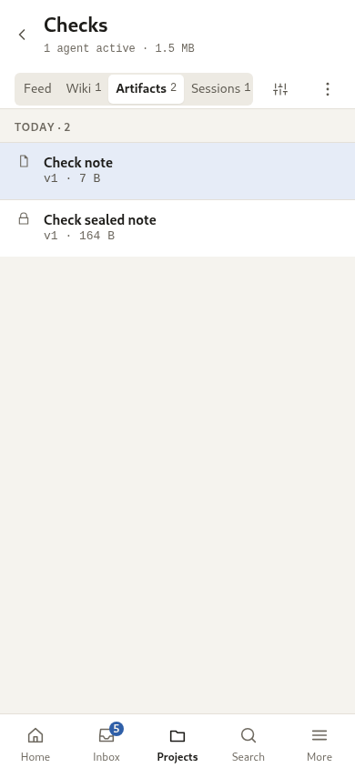
</picture>

### A sealed artifact, desktop

<picture>
  <source media="(prefers-color-scheme: dark)" srcset="assets/screens/artifact-viewer-desktop-dark.png">
  
</picture>

### A sealed artifact, phone

<picture>
  <source media="(prefers-color-scheme: dark)" srcset="assets/screens/artifact-viewer-phone-dark.png">
  
</picture>

## The knowledge base and its wiki

### Project wiki, desktop

<picture>
  <source media="(prefers-color-scheme: dark)" srcset="assets/screens/wiki-desktop-dark.png">
  
</picture>

### Project wiki, phone

<picture>
  <source media="(prefers-color-scheme: dark)" srcset="assets/screens/wiki-phone-dark.png">
  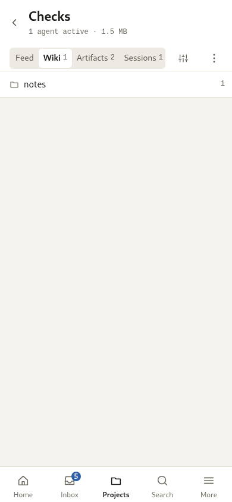
</picture>

### A knowledge base page, desktop

<picture>
  <source media="(prefers-color-scheme: dark)" srcset="assets/screens/wiki-reader-desktop-dark.png">
  
</picture>

### A knowledge base page, phone

<picture>
  <source media="(prefers-color-scheme: dark)" srcset="assets/screens/wiki-reader-phone-dark.png">
  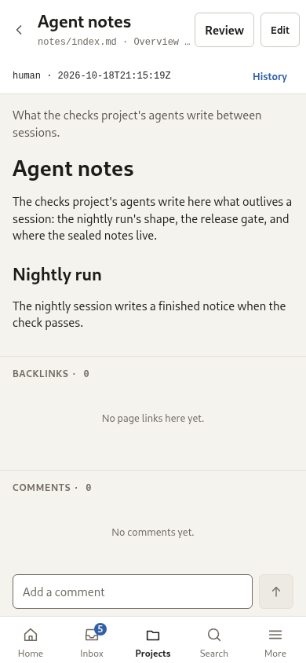
</picture>

### The wiki editor, desktop

<picture>
  <source media="(prefers-color-scheme: dark)" srcset="assets/screens/wiki-editor-desktop-dark.png">
  
</picture>

### A page's history, desktop

<picture>
  <source media="(prefers-color-scheme: dark)" srcset="assets/screens/wiki-history-desktop-dark.png">
  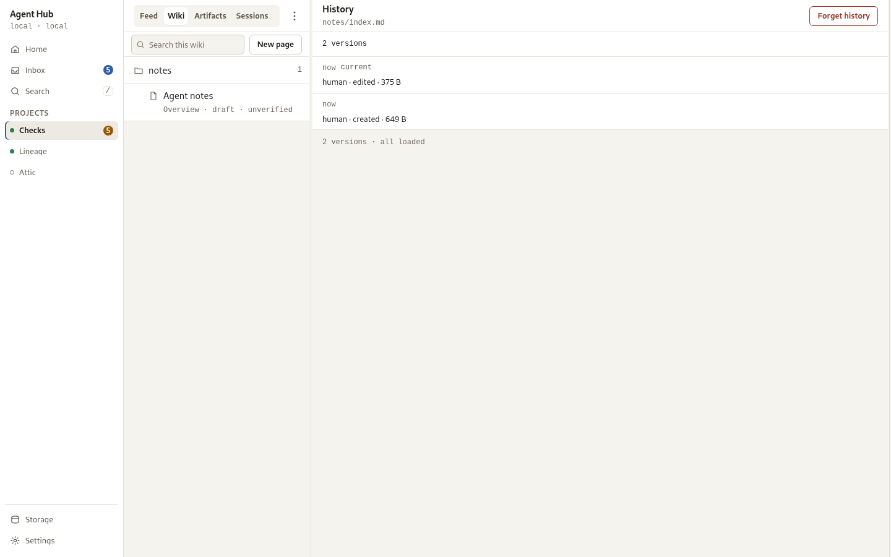
</picture>

### A version diff, desktop

<picture>
  <source media="(prefers-color-scheme: dark)" srcset="assets/screens/wiki-diff-desktop-dark.png">
  
</picture>

### A version diff, phone

<picture>
  <source media="(prefers-color-scheme: dark)" srcset="assets/screens/wiki-diff-phone-dark.png">
  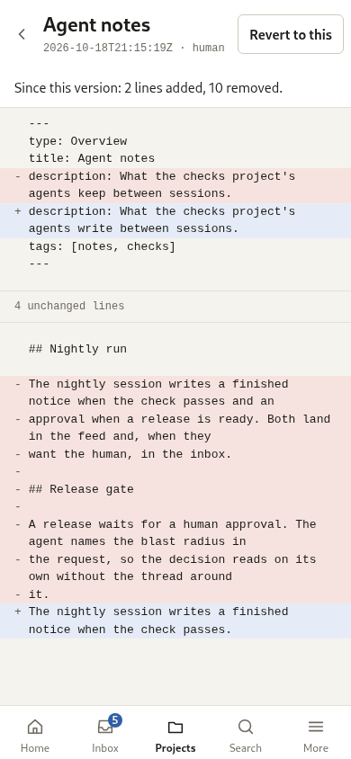
</picture>

## Search

### Search, desktop

<picture>
  <source media="(prefers-color-scheme: dark)" srcset="assets/screens/search-desktop-dark.png">
  
</picture>

### Search, phone

<picture>
  <source media="(prefers-color-scheme: dark)" srcset="assets/screens/search-phone-dark.png">
  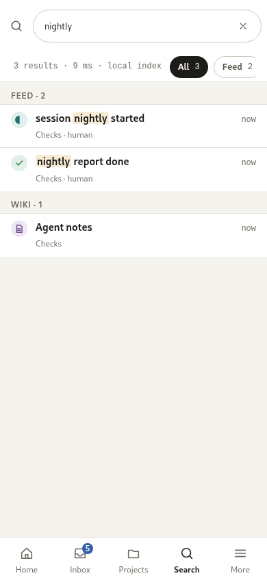
</picture>

## Storage and pruning

### Storage, desktop

<picture>
  <source media="(prefers-color-scheme: dark)" srcset="assets/screens/storage-desktop-dark.png">
  
</picture>

### Storage, phone

<picture>
  <source media="(prefers-color-scheme: dark)" srcset="assets/screens/storage-phone-dark.png">
  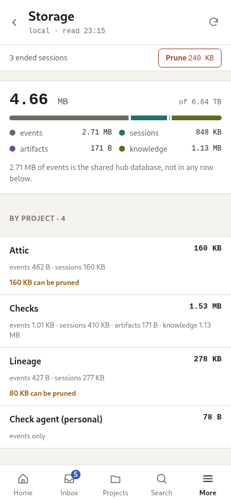
</picture>

## Settings and access

### Settings, desktop

<picture>
  <source media="(prefers-color-scheme: dark)" srcset="assets/screens/settings-desktop-dark.png">
  
</picture>

### Settings, phone

<picture>
  <source media="(prefers-color-scheme: dark)" srcset="assets/screens/settings-phone-dark.png">
  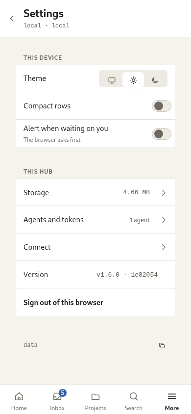
</picture>

### Access and tokens, desktop

<picture>
  <source media="(prefers-color-scheme: dark)" srcset="assets/screens/access-desktop-dark.png">
  
</picture>

### Access and tokens, phone

<picture>
  <source media="(prefers-color-scheme: dark)" srcset="assets/screens/access-phone-dark.png">
  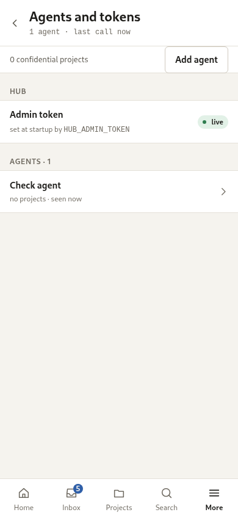
</picture>

### Connect an agent, desktop

<picture>
  <source media="(prefers-color-scheme: dark)" srcset="assets/screens/connect-desktop-dark.png">
  
</picture>

### Connect an agent, phone

<picture>
  <source media="(prefers-color-scheme: dark)" srcset="assets/screens/connect-phone-dark.png">
  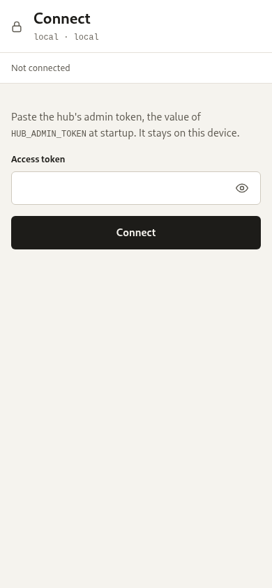
</picture>

### More, phone

<picture>
  <source media="(prefers-color-scheme: dark)" srcset="assets/screens/more-phone-dark.png">
  
</picture>

## Dialogs

### New project, desktop

<picture>
  <source media="(prefers-color-scheme: dark)" srcset="assets/screens/new-project-desktop-dark.png">
  
</picture>

### New project, phone

<picture>
  <source media="(prefers-color-scheme: dark)" srcset="assets/screens/new-project-phone-dark.png">
  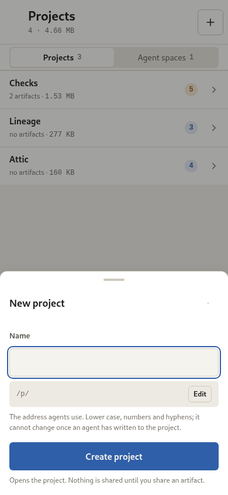
</picture>

### Delete a project, desktop

<picture>
  <source media="(prefers-color-scheme: dark)" srcset="assets/screens/delete-project-desktop-dark.png">
  
</picture>

### Delete a project, phone

<picture>
  <source media="(prefers-color-scheme: dark)" srcset="assets/screens/delete-project-phone-dark.png">
  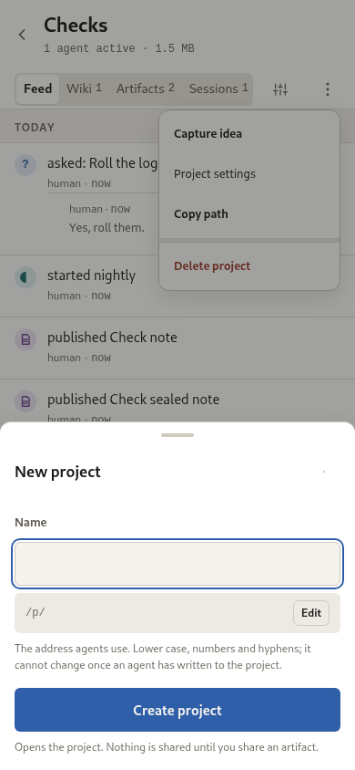
</picture>

### End a session, desktop

<picture>
  <source media="(prefers-color-scheme: dark)" srcset="assets/screens/end-session-desktop-dark.png">
  
</picture>

### End a session, phone

<picture>
  <source media="(prefers-color-scheme: dark)" srcset="assets/screens/end-session-phone-dark.png">
  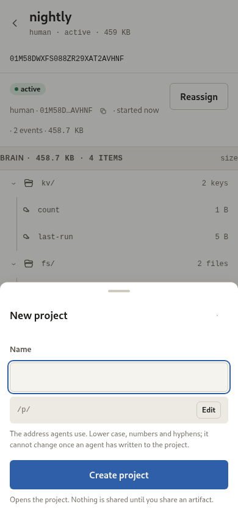
</picture>

### Prune, desktop

<picture>
  <source media="(prefers-color-scheme: dark)" srcset="assets/screens/prune-desktop-dark.png">
  
</picture>

### Prune, phone

<picture>
  <source media="(prefers-color-scheme: dark)" srcset="assets/screens/prune-phone-dark.png">
  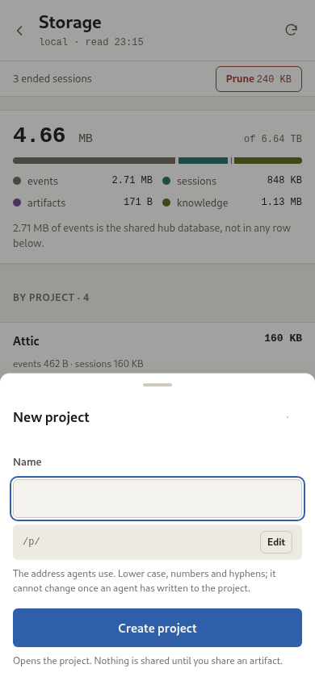
</picture>

### Issue a token, desktop

<picture>
  <source media="(prefers-color-scheme: dark)" srcset="assets/screens/issue-token-desktop-dark.png">
  
</picture>

### Revert, desktop

<picture>
  <source media="(prefers-color-scheme: dark)" srcset="assets/screens/revert-desktop-dark.png">
  
</picture>

### Revert, phone

<picture>
  <source media="(prefers-color-scheme: dark)" srcset="assets/screens/revert-phone-dark.png">
  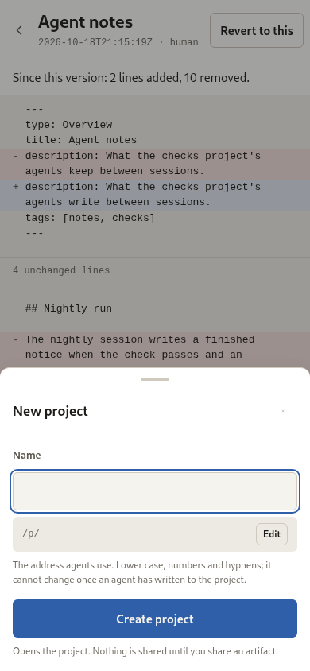
</picture>
