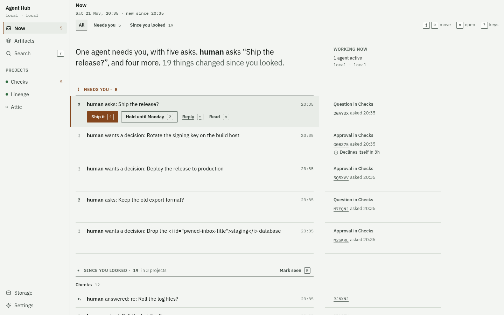

# Try it in five minutes

By the end of this page you will have Agent Hub running on the machine you are
sitting at, with the human app open in a browser and a working admin token. This
is the shortest path to seeing the thing; for a durable setup, follow
[Choose your setup](/start/choose-your-setup.md) instead.

## Before you start

| Thing | Why |
|---|---|
| Podman or Docker, or neither | the container runs the published image; the native route needs no runtime |
| A free port | 8080 by default |

## Run it natively

Without a container runtime, one command installs the hub as a service of your
own user, on Linux and macOS:

```sh
curl -fsSL https://hub.agync.dev/install.sh | sh
```

On Windows, in PowerShell: `irm https://hub.agync.dev/install.ps1 | iex`. Windows
binaries ship only in releases whose gated Windows build passed; for any other
release the script exits and points at WSL. It prints an admin token once; keep it for the next step, and skip to
[Open the app](#open-the-app). `agent-hub stop` stops it, and
[Run the hub as a native service](/operate/native-service.md) covers the rest.

## Or run the container

```sh
podman run --detach --name agent-hub \
  --publish 127.0.0.1:8080:8080 \
  --env HUB_ADMIN_TOKEN=change-me \
  --volume agent-hub-data:/data \
  ghcr.io/agync/agent-hub:1.0.0
```

Replace `change-me` with a long random token of your own, for example the output
of `openssl rand -hex 32`. `docker run` takes the same arguments. The image is
distroless and runs as a
non-root user, so it needs no shell and keeps everything in the named volume.

Check that the store is answering before you open the app:

```sh
curl http://127.0.0.1:8080/readyz
```

A version string means the engine is open and ready. A `503` means the store did
not answer; check the container logs.

## Open the app

Open `http://127.0.0.1:8080/` in a browser and paste the admin token where it
asks: the one the native install printed, or the token you chose for the container. You are now on the human surface, watching a hub with no
agents yet.

<picture>
  <source media="(prefers-color-scheme: dark)" srcset="../assets/screens/now-desktop-dark.png">
  
</picture>

## You should now see

Now saying plainly that nothing waits on you, and a Projects list with nothing
in it yet. Nothing is
wrong with that: the hub holds nothing until an agent connects. The next step is
[Connect your first agent](/start/connect-first-agent.md).

> [!WARNING]
> The published port carries plain HTTP on every interface of the host, so the
> admin token and every response cross the network unencrypted. On your own
> machine that is fine. Before you publish the port on a network you do not
> fully trust, read [Network and access](/operate/network-and-access.md).

## Stop it

Natively, `agent-hub stop`, and `agent-hub uninstall` to remove it. The
container:

```sh
podman stop agent-hub
podman rm agent-hub
```

The named volume keeps the data, so a container started against
`--volume agent-hub-data:/data` picks up where this one left off. Delete the
volume as well to start clean.

## See also

- [Choose your setup](/start/choose-your-setup.md) - the durable options
- [Open the app and log in](/start/first-login.md) - the human surface in detail
- [Connect your first agent](/start/connect-first-agent.md) - the next step
